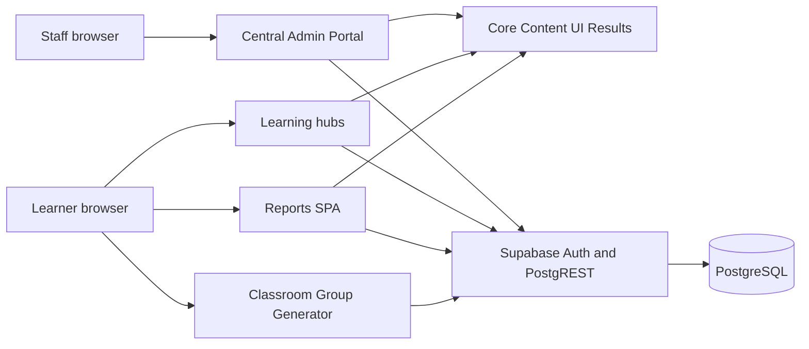
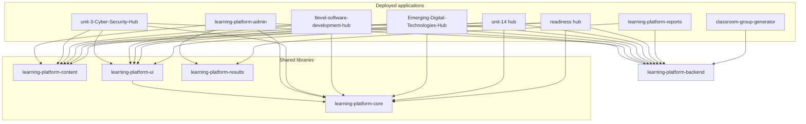

# 01 — System overview

The Learning Platform is a set of independently deployed web applications that share one Supabase/PostgreSQL project. Learner hubs present curriculum and submit evidence. The Central Admin Portal is the staff control plane. Shared npm packages, installed from sibling directories and pinned by git tag in GitHub Actions, hold the contracts those applications must follow.

The pattern is documented as **Contract-First Modular Hub Architecture** in `learning-platform-backend/docs/architecture.md`. That document is the platform’s own statement of intent. This file records what the inspected trees actually contain.

## Project purpose

Staff register hubs, author and publish curriculum, inspect learners and teaching groups, review attempts, and read analytics. Learners sign in to a hub, receive activities for their enrolments, and submit evidence. Marking, enrolment checks, and progress derivation run in PostgreSQL. The portal and the hubs do not call each other.

There is no custom application server between the browsers and Postgres. Supabase Auth issues the session. PostgREST exposes the `api` and `admin_api` schemas. PostgreSQL functions and Row Level Security are the backend.

## Technology stack

| Layer | Implementation found |
| --- | --- |
| Admin Portal UI | React 19.2.6, TypeScript 5.9.3, Tailwind CSS 4.2.1. Local dev uses vinext 1.0.0-beta.2. GitHub Pages uses a separate Vite 8 build (`vite.pages.config.ts`). |
| Hub UI | Vite 6 and React 19. Cyber Security, T Level and Emerging Digital Technologies follow this shape. Unit 3 and T Level still ship classic pages that call the same `api` schema. |
| Shared learner behaviour | `@learning-platform/core` (framework-free). React presentation is `@learning-platform/ui`. Curriculum documents are `@learning-platform/content`. Interpretation of stored results is `@learning-platform/results`. |
| Data access | `@supabase/supabase-js` 2.112.3 in the portal, hubs, Reports and the group generator. Backend package.json declares `^2.109.0` for ops scripts only. |
| Database | PostgreSQL 17 (`supabase/config.toml` in the backend). Schemas `learning`, `platform`, `library`, `api`, `admin_api`. |
| Auth | Supabase Auth. `auth.uid()` is the identity. Browsers are not supposed to send a learner id. |
| Deployment of front ends | GitHub Actions `pages.yml` → GitHub Pages. The portal also has a vinext/Cloudflare worker entry at `worker/index.ts`. No Vercel or Netlify config was found in the portal. |
| Backend deployment | SQL migrations in `learning-platform-backend/supabase/migrations/`. Hosted apply process is described in that repo’s `docs/migrations.md` and `docs/release-process.md`. This exercise did not apply migrations. |

Node for the portal is `>=22.13.0` (`package.json` `engines`). Hub CI uses Node 22. The package manager in every inspected JavaScript repository is npm (`package-lock.json`).

## Repository inventory

Versions below are the `package.json` versions in the **local checkout**, which are often behind or ahead of the git tag a GitHub Pages workflow pins. See [08 Development and deployment](08_DEVELOPMENT_AND_DEPLOYMENT.md).

| Repository | Purpose | Languages | Entry | Deployment | Status of the checkout |
| --- | --- | --- | --- | --- | --- |
| `learning-platform-admin` | Staff control plane. Reads `admin_api`. Authors and publishes curriculum. | TypeScript, CSS | `app/layout.tsx` (vinext) and `github-pages/main.tsx` (Pages) | GitHub Pages, path `/learning-platform-admin/` | Implemented staff client, version 0.2.0. Several writes are still a pending-action dialog. |
| `learning-platform-backend` | Schema, RLS, RPCs, seeds, pgTAP. Not a long-running Node server. | SQL, Python, a little JavaScript for ops | `supabase/migrations/`, `supabase/config.toml` | Supabase project (local CLI and hosted) | Implemented. README still says foundation 0.1.0; migrations continue through T Level Week 7 catalogue work. |
| `learning-platform-core` | Auth, onboarding, the only approved learner `api` client, submission, progress, DOM chrome, theme. | JavaScript | `src/index.js`, `src/advanced.js` | Library. Quality workflow only. | Library 0.2.23 in this checkout. Hub CI pins newer tags (0.2.20–0.2.27). |
| `learning-platform-content` | `lp.content.*` schemas, validation, import, render helpers, learner-safe stripping. | JavaScript | `src/validate.js` and the package exports | Library. No GitHub workflow in this checkout. | Library 0.1.4. Portal CI pins `v0.1.3`. |
| `learning-platform-ui` | React learner chrome and activity blocks. | TypeScript, React | `src/index.ts` | Library. | Library 0.1.13 here. Several hub workflows pin `v0.1.15`, which is not this checkout. |
| `learning-platform-results` | In-memory markbook, progress, diagnostics presentation, exports. No database client. | TypeScript | `src/index.ts` | Library. | 0.1.2. Consumed by the portal and by Reports. |
| `learning-platform-reports` | Standalone learner session-report SPA. Pilot hub `unit-3-cyber-security`. | TypeScript, React | `src/App.tsx` | GitHub Pages. README treats it as QA, not a general learner rollout. | Implemented SPA 0.1.1. |
| `learning-platform-cli` | `lp create hub` scaffold. | TypeScript | `dist/cli.js` bin `lp` | Not deployed. Quality workflow. | Hub creation works. Other commands are documented as not implemented. |
| `unit-3-Cyber-Security-Hub` | OCR Cambridge Technical Unit 3 learner hub. | TypeScript, JavaScript, HTML | `src/main.tsx` | GitHub Pages | Production-shaped hub. Catalogue player and a classic submit path both exist. |
| `tlevel-software-development-hub` | T Level Digital Software Development learner hub. | TypeScript, JavaScript | `src/main.tsx` | GitHub Pages | Production-shaped. Foundations use a classic `submitResult` path. Week content uses Core submission. |
| `Emerging-Digital-Technologies-Hub` | Gateway / L2E emerging technologies hub. Package name `l2e-exploring-emerging-digital-technologies`. | TypeScript | `src/main.tsx` | GitHub Pages | Production-shaped for weeks 1–3 on the inspected branch. |
| `unit-14-software-engineering-for-business-hub` | Unit 14 learner hub. | TypeScript | `src/main.tsx` | GitHub Pages | Separate real hub, not a copy. |
| `level-3-it-year-1-readiness-hub` | Induction readiness diagnostic. | TypeScript | `src/main.tsx` | GitHub Pages | Separate app. Uses diagnostic RPCs (`start_diagnostic` and related), not `submit_attempt`, for the sitting. |
| `classroom-group-generator` | Learner page for a join code. Sessions are created in the portal. | JavaScript | `src/main.js` | GitHub Pages | Implemented. No shared platform package. |
| `doc-generator` | College Word documents from JSON. | Python | `generate.py` | Not deployed | Authoring tool. No Supabase client. |
| `tlevel-software-development-api` | Older Google Apps Script backend (spreadsheet). | Apps Script | CLASP project | Manual Web App deploy | Legacy. No git remote. Not the current platform backend. |
| `tlevel-software-development-notion-template` | Notion workspace generator for T Level groups. | TypeScript | npm scripts `generate`, `provision` | Not deployed | Teacher provisioning tool. No git remote. No Supabase client. |

### Important directories

**Admin Portal** — `app/` routes, `github-pages/` static entry, `src/views/`, `src/services/`, `src/api/`, `src/content/`, `src/stores/`, `tests/`. Detail is in [02 Admin Portal architecture](02_ADMIN_PORTAL_ARCHITECTURE.md).

**Backend** — `supabase/migrations/` (103 timestamped SQL files in the inspected tree, from `20260809000100_create_learning_identity.sql` to `20261106150000_resolve_unbound_catalogue_marking.sql`), `supabase/tests/`, `docs/`, `scripts/import/`, `scripts/validation/`.

**A typical React hub** — `src/platform.ts` (Supabase client and `createPlatform`), `src/pages/`, `content/<hub>/package.json` (the `lp.content` package), `.github/workflows/pages.yml`.

### Dependencies between repositories

Local `package.json` files use `file:../…`. None of the inspected consumers use an npm registry version, a `github:` specifier, or a pnpm workspace protocol. The version that actually ships is the `ref:` in that app’s Pages workflow.

| Consumer | core | content | ui | results |
| --- | --- | --- | --- | --- |
| Admin Portal | `file:../learning-platform-core` (CI: default branch, no tag) | `file:` (CI tag `v0.1.3`) | not a dependency | `file:` (CI tag `v0.1.2`) |
| Unit 3 | CI `v0.2.27` | CI `v0.1.4` | CI `v0.1.15` | — |
| T Level | CI `v0.2.26` | CI `v0.1.4` | CI `v0.1.15` | — |
| Emerging (inspected branch) | CI `v0.2.20` | CI `v0.1.4` | CI `v0.1.11` | — |
| Unit 14 | CI `v0.2.22` | CI `v0.1.2` | CI `v0.1.14` | — |
| Readiness hub | CI `v0.2.5` | CI `v0.1.2` | CI `v0.1.8` | — |
| Reports | — | — | — | `file:` (CI checks out Results with no tag) |
| Group generator, doc-generator, CLI runtime | none | none | none | none |

The CLI writes `file:` dependencies into a new hub. Its baselines in `learning-platform-cli/src/shared/baselines.ts` are older than current packages (Core `0.2.2` in that file).

The arrows into the backend are runtime calls to one Supabase project, not npm dependencies. The backend repository is not imported by application code.

### Backend dependencies

Every live client uses the publishable Supabase key and one of:

- schema `admin_api` — portal (`createSupabaseAdminClient` in `src/services/supabase-admin-service.ts`);
- schema `api` — hubs, via `createLearnerApi` in Core, plus a few hub-local facades that call the same schema;
- schema `api` function `my_hub_activity_progress` — Reports (`learning-platform-reports/src/api/reporting-api.ts`);
- grouping RPCs that allow `anon` — classroom group generator.

`supabase/config.toml` exposes Data API schemas `public`, `graphql_public`, `api` and `admin_api`. No application tables were created in `public` by the migrations that were read.

### What is not a separate product

| Folder | What it is |
| --- | --- |
| `l2e-exploring-emerging-digital-technologies-hub` | Second checkout of Emerging Digital Technologies. Its Pages workflow pins a newer Core/UI pair than the `Emerging-Digital-Technologies-Hub` branch that was read. |
| `*-pages-hardening`, `_staging-activity-state-realtime`, `_release-activity-state-realtime`, `_admin-hub-results`, `_u14-formative` | Local working or staging trees. Not treated as extra products. |
| `agents` | Unrelated course materials. No git metadata. |

## Supporting utilities

These are features or scripts, not extra backends. Detail is in [07 Shared components and tools](07_SHARED_COMPONENTS_AND_TOOLS.md).

| Capability | Where it lives | Kind |
| --- | --- | --- |
| Classroom groups | Portal module Group Generator plus `classroom-group-generator` | Two production Pages apps sharing grouping RPCs |
| Diagnostic assessment | Readiness hub, `api.start_diagnostic` / `submit_diagnostic_response` / `complete_diagnostic`, portal views `diagnostic_*` | Production path, separate from `learning.attempts` |
| Activity authoring | Portal `src/content/` and `src/views/curriculum-authoring.tsx`; Excel template script `scripts/build-activity-template.mjs` | Portal feature, plus a dev script |
| Content validation | `@learning-platform/content` `validatePackage`; hub `check:learner-bundle`; backend `scripts/validation/validate_repository.py` | Libraries and CI scripts |
| Publication | `admin_api.publish_curriculum` called from the portal | Production RPC. Git commits are for application code, not for teaching-copy publication |
| Analytics | Portal `AnalyticsPage` over `admin_api` aggregate views, interpreted with `@learning-platform/results` | Production read path |
| Test data | Backend `supabase/seed.sql` and synthetic QA RPCs | Local seed and staff RPCs |
| Deployment | `.github/workflows/pages.yml` per app; backend `database-tests.yml` | CI |

## Why the system is split into repositories

`learning-platform-backend/docs/architecture.md` states the decision: one repository per package or hub, one Supabase project, browsers bound to `api` or `admin_api`. Inferred from that document and from the layout (no separate decision record was found beyond that file): hubs can ship on different schedules, a curriculum package can be published without redeploying a hub, and a shared contract can be reviewed once.

**Advantages that match the code**

- A hub deploy does not require an admin deploy. Pages workflows are per repository.
- Learner code cannot import `admin_api`. The portal client sets `db.schema` to `admin_api`. Core’s learner client refuses any schema other than `api` (`learning-platform-core/src/core/api/learner-api.js`).
- Teaching text can change through `publish_curriculum` without a Vite rebuild, as the backend architecture document describes for database-driven hubs.
- Postgres holds marking and authorisation once, for every hub.

**Disadvantages that match the code**

- Compatibility is a set of git tags, not a lockstep release. The portal CI pins Content `v0.1.3` while hubs pin `v0.1.4`. Core tags differ per hub (`v0.2.5` through `v0.2.27`). A backend RPC change can break an old hub before that hub’s workflow is updated.
- Local `file:` installs hide the pin. An engineer who runs `npm install` beside a newer sibling is not running the CI build.
- Two submission clients remain in Unit 3 and T Level (`js/core/supabase-learning-api.js`) beside Core’s `submitAttempt`. They can drift.
- There is no monorepo task that typechecks every consumer against one Core commit.
- Documentation inside hubs lags the workflows. Unit 3 `docs/core-integration.md` still names Core `v0.2.5`. T Level `docs/ARCHITECTURE.md` still describes a framework-free site.

## Implementation status of the ecosystem

| Area | Status |
| --- | --- |
| Shared identity, enrolments, attempts, RLS | Implemented in migrations |
| Learner submit and formative check RPCs | Implemented |
| Portal reads for people, attempts, analytics, diagnostics, hubs | Implemented |
| Portal hub registration, curriculum draft/publish, session visibility, teacher review, library, composition, grouping, hub-learning results | Implemented as RPC calls |
| Creating learners, teaching groups, enrolments, assignments from the portal | UI opens `PendingActionDialog`. No RPC is called. See [10 Implementation status](10_IMPLEMENTATION_STATUS_AND_ROADMAP.md) |
| Direct hub → portal HTTP | Not found |
| Edge Functions | `supabase/functions` does not exist |
| `units` table, `profiles` table, progress table | Not created. Courses contain `learning.modules`. Learners are `learning.students`. Progress is a view or function |

Related: [02 Admin Portal architecture](02_ADMIN_PORTAL_ARCHITECTURE.md), [06 Hub integration](06_HUB_INTEGRATION.md), [09 Engineering decisions](09_ENGINEERING_DECISIONS.md).
