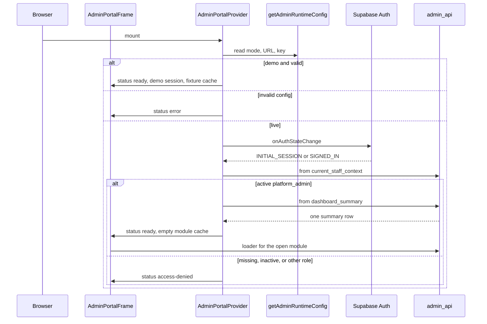

# 02 — Admin Portal architecture

The Central Admin Portal (`package.json` name `learning-platform-admin`, version `0.2.0`) is a staff client of the Supabase schema `admin_api`. It is not a learner hub. Demo mode renders frozen fixtures. Live mode signs in with Supabase Auth and mounts the shell only when `admin_api.current_staff_context` returns an active teacher whose `active_roles` includes `platform_admin`.

Inspected branch: `fix/phase-3-5-request-leakage`.

## Two front doors, one application

There is no `src/main.tsx`.

| Mode | Entry | Router |
| --- | --- | --- |
| `npm run dev` / vinext | `app/layout.tsx` renders `AdminPortalRoot` (`src/providers/admin-portal-root.tsx`), which renders `AdminPortalProvider`. `app/page.tsx` and `app/[module]/page.tsx` pass a module id into `AdminPortalFrame`. | Pathname. Dashboard is `/`. Other modules are `/${id}`. Unknown ids call `notFound()`. |
| GitHub Pages | `github-pages/index.html` loads `github-pages/main.tsx`. | Hash. `#/hubs` and the other module ids. An unknown hash becomes the dashboard. `applyAdminAuthCallbackLocation()` copies Auth callback parameters off the hash and onto the query string before the client reads them. |

`worker/index.ts` is a Cloudflare worker that serves the vinext handler. The Pages workflow builds with `vite.pages.config.ts` and uploads `dist/pages`. It does not deploy that worker. Whether the worker is used in any hosted environment was not verified from this repository alone.

`next.config.ts` is an empty config object consumed by vinext. It is not a Next.js deployment.

## Directory tree

```text
app/                         Vinext route files and global CSS
  layout.tsx                 Root document, theme, AdminPortalRoot
  page.tsx                   Dashboard
  [module]/page.tsx          One dynamic route for every other module id
github-pages/                Static Pages bootstrap
  index.html
  main.tsx                   createRoot, hash module, AdminPortalProvider
  next-link-stub.tsx         Stand-in for next/link in the Pages bundle
worker/index.ts              Vinext worker entry
src/api/                     View and RPC name constants, record types, service interfaces
  admin-api.ts               ADMIN_API_VIEWS, ADMIN_API_RPCS, AdminReadService
  admin-module-data.ts       Per-module cache types
src/analytics/               Client-side panes, filters, diagnostic presentation
src/components/              Shell widgets, sign-in, hub dialogs, authoring panels
src/content/                 Local curriculum authoring, validation, publication gate
src/layouts/admin-shell.tsx  Navigation chrome
src/providers/               Client root
src/results/                 Adapters over @learning-platform/results
src/router/modules.ts        Module registry
src/router/legacy-routes.ts  Unused redirect helper legacyRedirectTarget
src/services/                Config, Supabase client, loaders, demo fixtures
src/stores/                  React context for session and module cache
src/theme/                   createThemeService from @learning-platform/core
src/types/                   Ambient types for sibling packages
src/utils/                   Date and presentation helpers
src/views/                   Module pages
public/templates/            Excel activity template assets
scripts/build-activity-template.mjs
tests/                       node:test and a few jsdom/axe tests
```

Generated output (`dist/`, `.next/`, `node_modules/`) is omitted.

### Files that own behaviour

| File | Responsibility |
| --- | --- |
| `src/services/admin-runtime-config.ts` | `resolveAdminRuntimeConfig`, `getAdminRuntimeConfig`, `isBrowserSafeSupabaseKey` |
| `src/services/supabase-admin-service.ts` | Client, read service, hub/curriculum/review RPCs, error types |
| `src/services/admin-data-loaders.ts` | `loadAdminBootstrapData` and one loader per cached module |
| `src/services/demo-admin-service.ts` | `demoAdminService` fixture implementation of `AdminReadService` |
| `src/services/pending-admin-mutations.ts` | `pendingAdminMutations`, whose methods reject. **No UI import was found.** The buttons use `PendingActionDialog` instead. |
| `src/stores/admin-portal.tsx` | `AdminPortalProvider`, `useAdminPortal` |
| `src/stores/admin-session.ts` | `sessionFromStaffContext`, `canAccess` |
| `src/stores/admin-portal-auth.ts` | Callback URL helpers, sign-in error mapping, `shouldBootstrapAdminData` |
| `src/stores/admin-module-loader.ts` | Cache policy, `formatModuleLoadError` |
| `src/stores/use-admin-module-data.ts` | `useAdminModuleData` |
| `src/views/admin-portal-page.tsx` | `AdminPortalFrame` status gate |
| `src/views/module-content.tsx` | `ModuleContent` switch and `PendingActionDialog` host |
| `src/router/modules.ts` | `ADMIN_MODULES`, `getAdminModule`, `getModuleHref`, `isAdminModuleId` |

`canAccess` has no call sites outside its definition. A signed-in platform administrator receives `grantedActions: ["*"]`. Capability strings on modules (`dashboard.read`, `grouping.manage`, and the others) are labels. The shell does not hide modules with them.

## Configuration

`getAdminRuntimeConfig()` reads the compile-time object `__ADMIN_PUBLIC_ENV__`, injected by `vite.config.ts` and `vite.pages.config.ts` from `NEXT_PUBLIC_*` variables.

| Name | Role |
| --- | --- |
| `NEXT_PUBLIC_ADMIN_DATA_MODE` | `demo` (default when unset) or `live` |
| `NEXT_PUBLIC_SUPABASE_URL` | Required for a valid live config. Must be `http:` or `https:` |
| `NEXT_PUBLIC_SUPABASE_PUBLISHABLE_KEY` | Required for live mode. Accepted shapes are a key starting `sb_publishable_` or a JWT whose payload role is `anon`. Secret and service-role keys are rejected. |
| `NEXT_PUBLIC_GROUP_GENERATOR_URL` | Optional join-link base. Fallback in code: `https://acerosa.github.io/classroom-group-generator/` |

Invalid mode, or live mode without a safe URL and key, yields an invalid config. The portal then shows `AdminUnavailable`. It does not substitute demo data.

## Application initialisation



Functions, in order:

1. **Load.** Vinext: `RootLayout` → `AdminPortalRoot` → `AdminPortalProvider`. Pages: `github-pages/main.tsx` → `createRoot`.
2. **Environment.** `resolveAdminRuntimeConfig` in `src/services/admin-runtime-config.ts`.
3. **Supabase client.** `createSupabaseAdminClient` in `src/services/supabase-admin-service.ts`, only when `config.mode === "live"` and `config.valid`. Options: `db.schema = "admin_api"`, `auth.autoRefreshToken`, `persistSession`, `detectSessionInUrl`, `flowType: "pkce"`.
4. **Session restore.** The provider effect subscribes to `client.auth.onAuthStateChange`. `shouldBootstrapAdminData` (`src/stores/admin-portal-auth.ts`) allows bootstrap on `INITIAL_SESSION` and `SIGNED_IN` only. There is no separate `getSession()` call on first mount. The listener is the restore path. A recovery `token_hash` that has not been confirmed sets status `recovery-continue` and does not load data.
5. **Staff profile.** `createSupabaseAdminReadService(client).getCurrentStaffContext()` selects `current_staff_context`.
6. **Role.** `sessionFromStaffContext` (`src/stores/admin-session.ts`) requires `context.active` and `activeRoles` containing `"platform_admin"`. Otherwise status is `access-denied` and the message is `AUTH_USER_MESSAGES.forbidden`.
7. **Bootstrap read.** `fetchAdminBootstrapData` → `loadAdminBootstrapData` → `getDashboardSummary()` on view `dashboard_summary`. An empty summary throws `AdminReadError("access-denied")`.
8. **Module data.** Success sets `status: "ready"` and `bootstrapReady`. The module cache starts empty. `useAdminModuleData` calls `ensureModuleData` for the route. Group Generator, Content Library and Composition do not use that cache (`moduleDataKeyForRoute` is null). Those pages call `callRpc` themselves.
9. **Render.** `AdminPortalFrame` (`src/views/admin-portal-page.tsx`) chooses a screen from `portal.status`.
10. **Failures.** Module read errors stay inside the shell. `ModuleDataShell` shows `formatModuleLoadError` and Retry. A failed live read does not fall back to demo fixtures.

| `portal.status` | Screen |
| --- | --- |
| `recovery-continue` | `AdminRecoveryContinue` |
| `authenticating` | `AdminLoadingState` |
| `recovery` | `AdminPasswordReset` |
| `loading` before bootstrap | `AdminLoadingState` |
| `signed-out` | `AdminSignIn` |
| `access-denied` | `AdminAccessDenied`, with sign-out |
| `error` | `AdminUnavailable`, retry calls `refresh` |
| `ready` | `AdminShell` and `ModuleContent` |

Before a module read, `loadModuleData` calls `client.auth.getSession()`. A session error becomes `AdminReadError("unavailable")`. The role is not checked again at that point. The role gate is the bootstrap step. The database still enforces `platform_admin` inside each `admin_api` view. See [05 Authentication and security](05_AUTHENTICATION_AND_SECURITY.md).

## Routing

There is no React Router and no per-route wrapper. Every page sits behind the status gate.

Primary navigation (`PRIMARY_NAVIGATION_IDS` in `src/router/modules.ts`):

| Path | Module id | View |
| --- | --- | --- |
| `/` | `dashboard` | `DashboardPage` in `src/views/module-content.tsx` |
| `/hubs` | `hubs` | `HubRegistryPage` |
| `/people` | `people` | `PeopleArea` (learners, groups, staff) |
| `/assessment` | `assessment` | `ResultsArea` / assignments tab |
| `/analytics` | `analytics` | `AnalyticsPage` (`?pane=`) |
| `/group-generator` | `group-generator` | `GroupGeneratorPage` |
| `/system` | `system` | `SystemArea` |

Legacy ids stay reachable and are omitted from the sidebar (`visibleInNavigation: false`). `legacyRedirectTarget` would rewrite them. **Nothing calls it**, so the URL does not change. `docs/modules.md` says legacy routes resolve to primary areas. The screen is the aliased screen. The address bar is not rewritten. That is a documentation discrepancy.

| Legacy path | What renders |
| --- | --- |
| `/courses` | Hub registry, plus a notice that the course catalogue has moved |
| `/curriculum` | `CurriculumAuthoringPage` |
| `/content-library` | `ContentLibraryPage` |
| `/composition` | `CompositionPage` |
| `/activities` | Empty state. Copy reserves the route for a future group-delivery catalogue |
| `/learners`, `/enrolments` | People, learners tab. Enrolments adds the enrolment column |
| `/teachers` | People, staff tab |
| `/groups` | People, groups tab |
| `/assignments` | Assessment, assignments tab |
| `/results` | Assessment, results tab |
| `/attempts` | Results tab, markbook source forced |
| `/monitoring`, `/certification` | System, status tab |
| `/configuration` | System, advanced tab |
| `/audit` | System, audit tab |

Highlighting uses `resolveNavigationModule`. Pages hash routes use the same ids.

## State management

React context only (`AdminPortalProvider` / `useAdminPortal`). No Redux, Zustand, or TanStack Query.

The context holds runtime config, portal status, the staff session snapshot, the bootstrap summary, a per-module cache (`idle | loading | ready | refreshing | error`), a merged snapshot, the data-source banner, and auth messages. In-flight loads are deduped with a `Map`. Mutations that should refresh data mark keys and reload. Demo mode seeds the cache from `demoAdminService`.

| Storage | Key or owner | Contents |
| --- | --- | --- |
| Supabase Auth default storage | library | Session |
| `sessionStorage` | `lp-admin-password-recovery` | Recovery flow flag, not a role |
| `sessionStorage` | `lp-admin-grouping-session-id` | Open grouping session |
| `localStorage` | `lp.admin.authoring.records.v2` | Curriculum drafts (legacy key `lp.admin.authoring.drafts.v1`) |
| `sessionStorage` | `authoring-workspace-context.ts` | Authoring workspace |
| Core theme service | `@learning-platform/core` | Theme preference |

`src/theme/use-platform-theme.ts` calls `createThemeService`. The portal does not keep a second theme store.

## Shared UI

Shell: `src/layouts/admin-shell.tsx` (`AdminShell`), navigation from `primaryNavigationModules()`. Access screens live in `src/components/admin-access-gate.tsx`: `AdminLoadingState`, `AdminSignIn`, `AdminRecoveryContinue`, `AdminPasswordReset`, `AdminAccessDenied`, `AdminUnavailable`.

Authoring panels live under `src/components/authoring/`. They do not talk to Supabase directly. Curriculum authoring calls portal methods. Content Library and Composition call `callRpc` on the context.

Theme tokens come from Core. The portal does not depend on `@learning-platform/ui`.

## Error handling

| Layer | Type | Behaviour |
| --- | --- | --- |
| Reads | `AdminReadError` | Postgres `42501` → `access-denied`. Other PostgREST errors → `unavailable`. A non-array payload → `invalid-response`. |
| Hub writes | `AdminHubRegistrationError` | Message mapped from the Postgres error text onto the dialog |
| Publication and drafts | `AdminPublicationError` | Status, validation, version regression, draft conflict, authorisation |
| Review | `AdminReviewError` | Markbook strips a `REVIEW_*` prefix from the message |
| Dynamic RPC | `callRpc` in `AdminPortalProvider` | No client → `"Platform not connected"`. Supabase error → `throw new Error(error.message)` |
| Pending writes | `PendingActionDialog` | Explains that the mutation contract is not available. No request is sent |

`assertHubListMatchesSummary` (`src/services/admin-data-loaders.ts`) throws `unavailable` when the dashboard says there are active hubs and the hub list is empty.

## Build and tests

| Script | What it runs |
| --- | --- |
| `dev` | `vinext dev` |
| `build` | `vinext build` |
| `build:pages` | `vite build --config vite.pages.config.ts` |
| `start` | `vinext start` |
| `typecheck` | `tsc --noEmit` |
| `lint` | `eslint .` ignoring `dist` and `.next` |
| `test` | `build`, `build:pages`, `node --test tests/*.test.mjs`, then `test:authoring` |
| `test:unit` | `tests/architecture.test.mjs`, `tests/responsive.test.mjs` |
| `test:authoring` | `node --experimental-strip-types` on the TypeScript files listed in `package.json` |
| `test:accessibility` | build, then `tests/accessibility.test.mjs` (axe-core, jsdom) |
| `test:integration` | `tests/integration.test.ts` |

Runner is Node’s built-in test runner. Jest and Vitest are not used in this repository. pgTAP is in the backend repository, not here. `docs/testing.md` mentions database integration. That coverage is `supabase test db` in `learning-platform-backend`.

These commands were not executed while writing this document.

## Administrative modules

Permission for every module below is the shell gate: active `platform_admin`. Backend authorisation is the `WHERE` clause and the security-definer checks inside `admin_api`. The UI capability string is not consulted.

### Dashboard — implemented

Operational counts and lists.

- UI: `DashboardPage` in `src/views/module-content.tsx`.
- Loader: `loadDashboardData`.
- Views: `dashboard_summary`, `hubs`, `operational_health`, `recent_attempts`, `platform_contracts`.
- Writes: none.
- Tests present: `tests/routes.test.mjs`, `tests/architecture.test.mjs`, `tests/admin-module-loading-lifecycle.test.ts`, `tests/integration.test.ts` (`listRecentAttempts`). Not executed here.

### Hubs and curriculum (`/hubs`) — implemented

Search and filter the registry, course links, local draft week counts, publication status, health, and audit rows for one hub. Register, edit, and toggle `active`.

- UI: `HubRegistryPage`, `HubDetailDialog`, `RegisterHubDialog`.
- RPCs: `register_hub`, `update_hub`.
- Views: `hubs`, `hub_course_links`, `courses`, `curriculum_publications`, `curriculum_drafts`, `audit_events` via `loadHubsCurriculumData`.
- Errors: `AdminHubRegistrationError` on the dialog. Live mode is required.
- Tests present: `tests/hub-registration.test.ts`, `tests/integration.test.ts`.

`/courses` is the same registry plus a notice. Registry `dataState` is `"partial"`. There is no course editor.

### Curriculum authoring (`/curriculum`) — implemented

Weeks, sessions and activities as `lp.content` documents. Validation uses `@learning-platform/content`. Publication and visibility call the backend. Drafts also persist in `localStorage`.

- Page: `src/views/curriculum-authoring.tsx` (`CurriculumAuthoringPage`).
- Portal methods: `publishCurriculum`, `setSessionVisibility`, `saveCurriculumDraft`, `loadCurrentCurriculumPackage`, `getCurriculumDraft`, `discardCurriculumDraft`.
- RPCs: `publish_curriculum`, `set_session_visibility`, `save_curriculum_draft`, `current_curriculum_package`, `get_curriculum_draft`, `discard_curriculum_draft`.
- Local rules: `src/content/publication-gate.ts`, `hub-publication.ts`, `hub-health.ts`, `factories.ts`, `draft-store.ts`.
- Registry `dataState` is still `"partial"`.
- Tests present: `tests/authoring.test.ts`, `tests/publication.test.ts`, the week/session visibility suites, `tests/remote-draft.test.ts`, `tests/async-authoring.test.ts`.

`docs/architecture.md` says the authoring view never issues `.rpc(`. `curriculum-authoring.tsx` calls portal methods, and those methods issue `.rpc`. Content Library and Composition call `callRpc` themselves. The sentence in the older doc is true of the view file and incomplete for the feature.

### Content Library (`/content-library`) — implemented, live search

Reusable questions, activities and templates. Hidden from the primary nav. `dataState: "available"`.

- Page: `ContentLibraryPage`.
- RPCs called: `search_library`, `save_library_question`, `save_library_activity`, `delete_library_item`, `publish_library_item`, `archive_library_item`, `duplicate_library_item`.
- Declared in `ADMIN_API_RPCS` and not called from this page: `get_library_question_detail`.
- Library views in `ADMIN_API_VIEWS` are not selected with `.from()`. The page uses RPCs.
- Non-live mode skips the fetch.
- Tests: `tests/authoring-production.test.mjs` checks that the source contains `callRpc("search_library"`. No behavioural mutation suite was found.

### Composition (`/composition`) — implemented

Assemble a draft from templates, recipes and published library items, then save it as a curriculum draft. The page copy says this screen does not publish.

- Page: `src/views/composition.tsx`.
- Local engine: `src/content/composition-engine.ts`, `composition-persistence.ts`, `materialise.ts`.
- RPCs called include `search_library`, `list_composition_templates`, `list_curriculum_recipes`, `save_composition_draft_state`, `get_curriculum_draft`, `get_composition_draft_state`, template and recipe save/duplicate/archive/restore, and `save_curriculum_draft`.
- Declared and not called from the page: `save_composition_reference`, `detach_composition_reference`, `composition_update_check`, `composition_impact_analysis`.
- Tests present: `tests/composition-engine.test.ts`, `tests/materialise.test.ts`.

### Activities (`/activities`) — not implemented

`DeferredLearningPage` states that the route is reserved for a future group-delivery catalogue. Registry `dataState: "pending"`. No Supabase call.

### People — reads implemented, writes not implemented

`PeopleArea` (`src/views/people-area.tsx`) with `LearnersPanel`, `GroupsPanel`, `StaffPanel` (`src/views/admin-people-panels.tsx`).

- Loader: `loadPeopleData`.
- Views: `learners`, `groups`, `staff_roles` (shown as staff), `enrolments`.
- Buttons “Add learner”, “Create a group” and “Invite a teacher” call `openPending`. The dialog does not call the network.
- Enrolments are a column on the learners panel (`/enrolments`), not a separate editor.
- Academic years are columns on `admin_api.groups` (`academic_year`). There is no academic-year screen.
- Staff `dataState` in the registry is `"partial"`.

### Assignments — reads implemented, create not implemented

`AssignmentsPanel` lists view `assignments`. “Create assignment” opens the pending dialog. The notice says creation stays disabled until an audited idempotent RPC exists. That RPC was not found in the portal client.

The shared loader `loadAssignmentsResultsData` also loads attempts, responses, activity performance and diagnostics for the results screens.

### Results and markbook — implemented

`ResultsArea` (`src/results/result-sources.ts`):

| Source | UI |
| --- | --- |
| Induction / readiness | `ReadinessDiagnosticPage` |
| Assignment markbook | `ResultsMarkbookPage` (`src/views/results-markbook.tsx`) via `src/results/from-admin-snapshot.ts` and `@learning-platform/results` |
| L2E, Unit 3, T Level, Unit 14 | `HubLearningResultsPage` and the hub-learning RPCs below |
| L3E | `kind: "unavailable"`. Copy says no L3E hub is registered |

`/attempts` forces the markbook source (`includeAttempts`).

Teacher review calls `reviewResponse` → RPC `review_response` in live mode. Demo mode mutates the in-memory snapshot.

`ResultsPanel` in `src/views/admin-assessment-panels.tsx` is exported and unused. The results UI is `ResultsArea`.

Hub-learning RPCs are called and are **absent** from `ADMIN_API_RPCS`:

- `list_hub_learning_result_filters` (`p_hub_code`)
- `list_hub_learning_results` and `summarise_hub_learning_results` with `hubLearningRpcParams`
- `list_hub_learning_result_evidence` (`p_hub_code`, `p_student_number`, `p_assignment_id`)

Demo mode uses fixtures in `src/results/hub-learning.ts` and does not call those RPCs.

Tests present: `tests/results-markbook.test.ts`, `tests/results-induction.test.ts`, `tests/results-hub.test.ts`, `tests/integration.test.ts` (review arguments).

### Readiness diagnostic — implemented, not its own route

`ReadinessDiagnosticPage` and `src/analytics/diagnostic.ts`. Views: `diagnostic_sessions`, `diagnostic_responses`, `diagnostic_summary`. Also an analytics pane `readiness-diagnostic`. Question text is not on `admin_api`. The UI shows identifiers. That limitation is stated in `src/analytics/diagnostic.ts`.

Tests present: `tests/readiness-diagnostic.test.ts`, `tests/results-induction.test.ts`.

### Analytics — implemented

`AnalyticsPage` panes in `src/analytics/scope.ts`: overview, groups, learners, activities, questions, topics-skills, readiness, readiness-diagnostic, attention. Filters run in the browser over the loaded snapshot. Readiness and attention use `assessmentReadinessFromSnapshot` and `interventionSignalsFromSnapshot` from the results package.

Views: `assessment_overview`, `group_performance`, `learner_performance`, `learner_activity_performance` (paged), `activity_analytics` (paged), `question_performance` (paged), `question_group_performance` (paged), `topic_performance`, `skill_performance`, plus the three diagnostic views.

Page size is `ADMIN_READ_PAGE_SIZE` (1000) with `.range`. Tests present: `tests/analytics.test.ts`, `tests/admin-read-pagination.test.ts`.

There is no separate “generate analytics” job. Opening the page reads the views.

### Group Generator — implemented

`GroupGeneratorPage` creates a classroom grouping session, polls `get_grouping_session` every 2500 ms while `groupingPollShouldRun` (`src/views/grouping-poll.ts`), then generates, renames, assigns roles, publishes, rebalances and closes. This does not insert `learning.groups`.

RPCs and arguments:

| RPC | Arguments |
| --- | --- |
| `create_grouping_session` | `p_session_name`, `p_preferred_group_size`, `p_specialist_role_title` |
| `get_grouping_session` | `p_session_id` |
| `remove_grouping_participant` | `p_participant_id` |
| `generate_grouping_teams` | `p_session_id`, `p_preferred_group_size` |
| `rename_grouping_team` | `p_team_id`, `p_display_name` |
| `set_grouping_participant_role` | `p_participant_id`, `p_role_type` |
| `move_grouping_participant` | `p_participant_id`, `p_team_id` |
| `publish_grouping_session` | `p_session_id` |
| `assign_late_grouping_participant` | `p_participant_id`, `p_team_id`, `p_to_smallest` |
| `rebalance_grouping_session` | `p_session_id`, `p_preferred_group_size` |
| `close_grouping_session` | `p_session_id` |

`set_grouping_session_specialist_role` is declared and not called. View `grouping_sessions` is named in `ADMIN_API_VIEWS` and not selected with `.from()`.

Tests present: `tests/group-generator-poll.test.ts`, `tests/group-generator-roles.test.ts`.

### System — partial

`SystemArea`: status (`operational_health`, `hubs`), audit (`audit_events`), access (`staff_roles`), advanced (“Propose change” → pending dialog). Loader: `loadSystemData`. Registry `dataState: "partial"`.

### Progress and settings

There is no `/progress` module. Markbook progress is `createLearnerProgress` in `src/results/from-admin-snapshot.ts`, built from attempt rows. Hub-learning completion is a column on those RPC rows.

There is no `/settings` route. Theme is the shell toggle. Configuration writes are the pending dialog on the advanced tab.

## Contract drift inside this repository

`ADMIN_API_CONTRACT` in `src/api/admin-api.ts` is version `"0.2.0"`, status `"draft"`, mode `"read-models-with-hub-registration-curriculum-publication-and-teacher-review"`.

- View `recent_attempts` is queried and is not listed in `ADMIN_API_VIEWS`.
- Ten library, composition and grouping views are listed and never passed to `.from()`.
- Four hub-learning RPCs are called and not listed in `ADMIN_API_RPCS`.
- README still says six primary areas. The code and `tests/architecture.test.mjs` register seven, including Group Generator.
- README’s write list is shorter than the RPC list in section “Administrative modules”.

The call inventory with inputs and database objects is [03 Backend integration](03_BACKEND_INTEGRATION.md).
