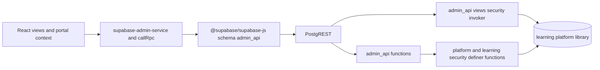

# 03 — Backend integration

The Admin Portal talks to PostgreSQL through the Supabase JavaScript client. The client is bound to the `admin_api` schema. PostgREST turns `.from()` into reads of views and `.rpc()` into calls of functions. No Edge Function, no `functions.invoke`, and no hand-written `/rest/v1` URL was found in this repository. The only `fetch` in application code is `worker/index.ts`, which serves the vinext app.



Why this shape, as implemented: the browser holds a publishable key. Privileged SQL runs as `SECURITY DEFINER` inside the database after `platform.current_staff_has_role` (or a narrower helper) succeeds. Views are `security_invoker = true`, so the caller’s RLS still applies, and the view’s own `WHERE` clause demands `platform_admin` on the staff read models that were inspected (`admin_api.learners`, `admin_api.groups`, `admin_api.attempts`).

Hubs do not use this path. They use schema `api`. See [06 Hub integration](06_HUB_INTEGRATION.md).

## Client construction

`createSupabaseAdminClient` (`src/services/supabase-admin-service.ts`):

- URL and publishable key from `getAdminRuntimeConfig()`.
- `createClient(url, publishableKey, { db: { schema: "admin_api" }, auth: { autoRefreshToken: true, persistSession: true, detectSessionInUrl: true, flowType: "pkce" } })`.
- Throws if the config is not a valid live config.

`callRpc` (`AdminPortalProvider` in `src/stores/admin-portal.tsx`) calls `client.schema("admin_api").rpc(name, params)`. It returns an array. A Supabase error becomes `Error(error.message)`.

Reads go through `createSupabaseAdminReadService`. Failures become `AdminReadError`. Paged methods use `.range` in steps of 1000 (`ADMIN_READ_PAGE_SIZE`).

Authentication on every live call is the Supabase user JWT. Authorisation is not a second header. It is the SQL predicate described in [05 Authentication and security](05_AUTHENTICATION_AND_SECURITY.md).

## Auth interfaces

Called from `src/stores/admin-portal.tsx` unless noted. All require the live client. None of these read `learning` tables by themselves. Staff authority is the following `current_staff_context` read.

| Interface | Called from | Purpose | Input | Failure |
| --- | --- | --- | --- | --- |
| `auth.signInWithPassword` | `signInAdminWithPassword` | Password sign-in | email, password | `signIn` maps the error with `mapSignInError` |
| `auth.signInWithOtp` | `requestMagicLink` | Magic link. `shouldCreateUser: false` | email, `emailRedirectTo` | `magicLinkFailed` or `magicLinkSent` |
| `auth.resetPasswordForEmail` | `requestAdminPasswordReset` | Recovery email | email | Network failure has its own message. Other errors still show the generic “if an account exists” text |
| `auth.verifyOtp` | `verifyAdminRecoveryTokenHash` | Recovery, type `recovery` | `token_hash` | Only after the user presses Continue. `mapRecoveryVerifyError` |
| `auth.updateUser` | `updateAdminPassword` | Set a new password | `{ password }` | `mapPasswordUpdateError` |
| `auth.signUp` | `registerAdminAccount` | Create an Auth user | email, password | `AdminAuthError("registration-failed")`. **Not used by the sign-in screen.** Integration tests call it |
| `auth.getSession` | `refresh`, `loadModuleData`, `updatePassword` | Read the cached session | none | Module load treats a session error as unavailable |
| `auth.onAuthStateChange` | provider effect | Restore and sign-out | callback | Drives bootstrap |
| `auth.signOut` | `signOut` | End the session | none | Portal state is cleared |
| RPC `claim_initial_platform_admin` | `claimInitialPlatformAdmin` | Bootstrap the first admin | `p_bootstrap_token` | `AdminAuthError("bootstrap-failed")`. **Not used by the UI.** `docs/permissions.md` says the first administrator is created with privileged SQL |

Fictitious password sign-in, as the client sends it (values are examples, not accounts):

```json
{ "email": "ada.admin@example.test", "password": "not-a-real-password" }
```

The Auth response is a Supabase session. The portal then selects `current_staff_context` and only then treats the user as an administrator.

## Read views

Every row is `client.schema("admin_api").from(view).select(...)`. The method names are on `createSupabaseAdminReadService`. Loaders in `src/services/admin-data-loaders.ts` call those methods. `loadAdminData` calls all of them in one `Promise.all` and remains for the full-snapshot path used by integration tests. The running UI uses the per-module loaders.

Authentication: signed-in JWT. Authorisation: view predicate `platform.current_staff_has_role('platform_admin')` on the learner and attempt views inspected in migrations, plus RLS on the base tables. `current_staff_context` is filtered to `learning.current_teacher_id()` instead. An empty `dashboard_summary` is treated as `access-denied` by the client.

Database objects are the view plus the `learning` / `platform` tables in its `FROM` clause. Representative definitions:

| View | Base objects seen in SQL |
| --- | --- |
| `current_staff_context` | `learning.teachers`, `platform.staff_roles` |
| `learners` | `learning.students`, `learning.enrolments`, `learning.groups` |
| `groups` | `learning.groups`, `learning.academic_years`, `learning.courses`, `learning.enrolments` |
| `attempts` | `learning.attempts`, `students`, `activity_versions`, `activities`, `activity_assignments`, `groups`, `responses` |

| Method | View | Paged | Purpose | Status |
| --- | --- | --- | --- | --- |
| `getCurrentStaffContext` | `current_staff_context` | no | Staff id, name, active flag, roles | Implemented |
| `getDashboardSummary` | `dashboard_summary` | no | Bootstrap counts. Empty → access denied | Implemented |
| `listHubs` | `hubs` | no | Hub registry | Implemented |
| `listHubCourseLinks` | `hub_course_links` | no | Hub-to-course links | Implemented |
| `listCourses` | `courses` | no | Course catalogue | Implemented |
| `listContracts` | `platform_contracts` | no | Contract versions | Implemented |
| `listHealth` | `operational_health` | no | Service health rows | Implemented |
| `listTeachers` | `staff_roles` | no | Staff and roles, ordered by display name | Implemented |
| `listLearners` | `learners` | no | Learner list | Implemented |
| `listGroups` | `groups` | no | Teaching groups | Implemented |
| `listEnrolments` | `enrolments` | no | Enrolment rows | Implemented |
| `listAssignments` | `assignments` | no | Activity assignments | Implemented |
| `listAttempts` | `attempts` | no | Attempt rows for the markbook | Implemented |
| `listRecentAttempts` | `recent_attempts` | no | Dashboard recent attempts. **Not listed in `ADMIN_API_VIEWS`** | Implemented |
| `listResponses` | `responses` | no | Response rows, including review fields | Implemented |
| `listActivityPerformance` | `activity_performance` | no | Per-activity performance | Implemented |
| `getAssessmentOverview` | `assessment_overview` | no | Analytics headline | Implemented |
| `listGroupPerformance` | `group_performance` | no | Per teaching group | Implemented |
| `listLearnerPerformance` | `learner_performance` | no | Per learner | Implemented |
| `listLearnerActivityPerformance` | `learner_activity_performance` | yes | Learner × activity | Implemented |
| `listActivityAnalytics` | `activity_analytics` | yes | Activity × group | Implemented |
| `listQuestionPerformance` | `question_performance` | yes | Question totals | Implemented |
| `listQuestionGroupPerformance` | `question_group_performance` | yes | Question × group | Implemented |
| `listTopicPerformance` | `topic_performance` | no | Topic roll-up | Implemented |
| `listSkillPerformance` | `skill_performance` | no | Skill roll-up | Implemented |
| `listDiagnosticSessions` | `diagnostic_sessions` | yes | Readiness sittings | Implemented |
| `listDiagnosticResponses` | `diagnostic_responses` | yes | Diagnostic answers | Implemented |
| `listDiagnosticSummary` | `diagnostic_summary` | no | Diagnostic roll-up | Implemented |
| `listAuditEvents` | `audit_events` | no | Audit feed | Implemented |
| `listCurriculumPublications` | `curriculum_publications` | no | Publication history, without the package body on the list view | Implemented |
| `listCurriculumDrafts` | `curriculum_drafts` | no | Remote drafts | Implemented |

Views named in `ADMIN_API_VIEWS` and never passed to `.from()` in this repository: `library_questions`, `library_activities`, `library_templates`, `library_resources`, `library_feedback`, `library_hints`, `composition_references`, `composition_templates`, `curriculum_recipes`, `grouping_sessions`. Those features use RPCs. Status of the views themselves: present in the contract constant; unused by the UI.

Fictitious `learners` row after the client maps columns (shape from `LearnerRecord` in `src/api/admin-api.ts`):

```json
{
  "studentNumber": "S10001",
  "displayName": "Alex Example",
  "active": true,
  "groupCodes": ["U3-Y1-A"],
  "activeEnrolmentCount": 1
}
```

The view also selects `learner_id`, `is_synthetic` and `synthetic_purpose`. The record type used by the panels does not expose contact email. The SQL comment on the earlier learner view says contact details are excluded.

Ordering follows the service: hubs by `hub_name`, learners by `student_number`, groups by `group_code`, enrolments by `joined_on` descending, attempts by `completed_at` descending, audit events by `occurred_at` descending. Exact column lists are in `supabase-admin-service.ts`.

## RPC functions the portal calls

Schema `admin_api` unless noted. Authentication: JWT. Authorisation: inside the function (usually a `platform.*` security-definer body). The portal maps failures onto the error classes in [02 Admin Portal architecture](02_ADMIN_PORTAL_ARCHITECTURE.md).

### Typed methods in `supabase-admin-service.ts`

| RPC | Function | Input | Purpose | Status |
| --- | --- | --- | --- | --- |
| `register_hub` | `registerHub` | `p_manifest`, `p_status`, `p_active` | Insert a hub from a manifest | Implemented |
| `update_hub` | `updateHub` | `p_hub_code`, `p_manifest`, `p_status`, `p_active` | Update that hub | Implemented |
| `publish_curriculum` | `publishCurriculum` | `platformPublicationArgs(record)` | Publish an approved package | Implemented |
| `set_session_visibility` | `setSessionVisibility` | `p_hub_code`, `p_course_key`, `p_session_id`, `p_status` (`available` or `planned`) | Show or hide a session | Implemented |
| `save_curriculum_draft` | `saveCurriculumDraft` | `p_draft_id`, `p_hub_code`, `p_course_key`, `p_title`, `p_lifecycle_status`, `p_expected_revision`, `p_package`, `p_based_on_package_version` | Optimistic draft save | Implemented |
| `current_curriculum_package` | `loadCurrentCurriculumPackage` | `p_hub_code`, `p_course_key` | Current published package for authoring | Implemented |
| `get_curriculum_draft` | `getCurriculumDraft` | `p_draft_id` | Load one draft | Implemented |
| `discard_curriculum_draft` | `discardCurriculumDraft` | `p_draft_id` | Discard a draft | Implemented. Portal method exists |
| `review_response` | `reviewResponse` | `p_response_id`, `p_awarded_score`, `p_is_correct`, `p_feedback_summary`, `p_feedback_next_step` | Teacher mark and feedback. Does not replace `response_payload` | Implemented |
| `claim_initial_platform_admin` | `claimInitialPlatformAdmin` | `p_bootstrap_token` | First-admin claim | Service and tests only |

Fictitious `review_response` arguments:

```json
{
  "p_response_id": "00000000-0000-4000-8000-000000000001",
  "p_awarded_score": 1,
  "p_is_correct": true,
  "p_feedback_summary": "The CIA explanation matches the taught definition.",
  "p_feedback_next_step": "Apply the same terms to the next scenario."
}
```

A successful review returns the updated response projection. The portal then invalidates the results cache. Draft save does not invalidate the module cache.

### `callRpc` names used by pages

Content Library, Composition and Group Generator argument lists are in [02 Admin Portal architecture](02_ADMIN_PORTAL_ARCHITECTURE.md). Hub-learning parameters from `hubLearningRpcParams`:

`p_hub_code`, `p_course_key`, `p_group_code`, `p_student_number`, `p_week_number`, `p_session_number`, `p_activity_key`, `p_completion_status`.

Evidence: `p_hub_code`, `p_student_number`, `p_assignment_id`.

| RPC | Page | Status |
| --- | --- | --- |
| `search_library`, `save_library_question`, `save_library_activity`, `delete_library_item`, `publish_library_item`, `archive_library_item`, `duplicate_library_item` | Content Library | Implemented |
| `get_library_question_detail` | declared only | Not called |
| Composition list/save/archive/restore/duplicate for templates, recipes and draft state | Composition | Implemented |
| `save_composition_reference`, `detach_composition_reference`, `composition_update_check`, `composition_impact_analysis` | declared only | Not called |
| Grouping RPCs listed in document 02, except `set_grouping_session_specialist_role` | Group Generator | Implemented |
| `set_grouping_session_specialist_role` | declared only | Not called |
| `list_hub_learning_result_filters`, `list_hub_learning_results`, `summarise_hub_learning_results`, `list_hub_learning_result_evidence` | Hub learning results | Implemented. Names missing from `ADMIN_API_RPCS` |

Library and composition RPCs in the backend call `library.is_content_author()`, which is true for `platform_admin` or `curriculum_admin`. The portal shell still requires `platform_admin`, so a curriculum administrator cannot open the UI even though the RPC would accept them. That is a product boundary, verified in `sessionFromStaffContext`, not a second role inside the shell.

Hub-learning RPCs use `learning.staff_can_read_hub_results`, which is true for `platform_admin` **or** a teacher with `teacher_can_access_group` on a hub-bound group (`20260913180000_admin_hub_learning_results.sql`). The same shell gate means a teacher who is not `platform_admin` never reaches the page. Direct PostgREST calls are a different matter and are covered in [05 Authentication and security](05_AUTHENTICATION_AND_SECURITY.md).

## Writes the UI does not send

`PendingActionDialog` (`src/views/module-content.tsx`) is the handler for:

- add learner;
- create a teaching group;
- invite a teacher;
- create an assignment;
- propose a platform configuration change.

`ADMIN_MUTATION_STATUS` still describes those mutation RPCs as unspecified. No matching `.rpc` was found in the portal for inserting `learning.students`, `learning.groups`, `learning.enrolments` or `learning.activity_assignments`.

`pendingAdminMutations` in `src/services/pending-admin-mutations.ts` rejects `registerHub` and `updateHub` as well. The live dialogs do not use that object. They call `registerHub` and `updateHub` in the Supabase service. The pending module is stale relative to the UI.

## Traces

### 1. Administrator authentication

1. `AdminSignIn` calls `signIn` on the portal context.
2. `signInAdminWithPassword` calls `auth.signInWithPassword`.
3. `onAuthStateChange` receives `SIGNED_IN`.
4. `bootstrapSession` calls `getCurrentStaffContext`.
5. SQL view `admin_api.current_staff_context` keeps the row only when `teacher.id = learning.current_teacher_id()` and `teacher.active`.
6. `sessionFromStaffContext` requires `platform_admin`.
7. `getDashboardSummary` must return a row.
8. `AdminPortalFrame` renders the shell.

Errors: bad password stays on the sign-in form. A learner or a teacher without `platform_admin` reaches `AdminAccessDenied`. An empty dashboard summary is also access denied. Network and PostgREST failures use `AdminUnavailable` or the auth error mapper.

Sequence diagram: [11 End-to-end workflows](11_END_TO_END_WORKFLOWS.md).

### 2. Retrieving learners

1. Route `/people` or `/learners`.
2. `useAdminModuleData` → `loadPeopleData`.
3. `listLearners` → `from("learners")`.
4. View `admin_api.learners` (`20260902100000_synthetic_qa_learner_fixtures.sql`) reads `learning.students` and active enrolment group codes.
5. Predicate: `(select platform.current_staff_has_role('platform_admin'))`.
6. `LearnersPanel` renders `studentNumber`, `displayName`, groups and enrolment count.

Errors: `AdminReadError` inside `ModuleDataShell`, with Retry. No demo fallback in live mode.

### 3. Creating or updating a teaching group

**Not implemented in the portal.** “Create a group” calls `openPending({ title: "Create a group" })`. The database table `learning.groups` exists. No portal function inserts it.

Updating a group was also not found. Hub registration updates `platform.hubs`, which is a different entity.

### 4. Enrolling a learner

**Not implemented in the portal.** Enrolments are displayed from `admin_api.enrolments`. There is no enrol button that calls an RPC.

Learner-driven enrolment does exist on the hub side: `api.resolve_learner_hub_access` and `api.join_learner_hub_group`. That path is documented in [06 Hub integration](06_HUB_INTEGRATION.md). It is not an admin operation.

### 5. Assigning an activity

**Not implemented in the portal.** Assignments are listed from `admin_api.assignments`. Creation opens the pending dialog. Catalogue publication (`publish_curriculum`) projects activities into the learning catalogue. That is publication, not `learning.activity_assignments` for a group. The distinction matters: a published activity is not automatically an assignment for a teaching group unless a later migration or seed inserts `activity_assignments`. Those inserts exist in seeds and data migrations. They are not a portal action.

### 6. Retrieving learner progress

Two implemented reads:

- Markbook: `listAttempts` and related views, then `createLearnerProgress` in `src/results/from-admin-snapshot.ts`.
- Hub results: `list_hub_learning_results` / `summarise_hub_learning_results`. Backend comment in `20260913180000_admin_hub_learning_results.sql`: official scores come from completed attempts. Formative checks and `activity_states` contribute completion only. Current membership uses active enrolments. Hub isolation uses `platform.hub_group_links`, not course links alone, because several hubs share a course key.

### 7. Viewing assessment results

Same loaders as progress, plus `listResponses` and `review_response` when a teacher confirms a mark. Diagnostic sittings use `diagnostic_sessions`, `diagnostic_responses` and `diagnostic_summary`, which read `learning.diagnostic_*`, not `learning.attempts`.

### 8. Generating analytics

Opening `/analytics` calls `loadAnalyticsData`, which selects the aggregate views. Aggregation is SQL in those views (definitions in the analytics migrations, including replacements in `20260902200000`). The browser filters and calls `@learning-platform/results` helpers. There is no separate generate endpoint.

## Error catalogue the client expects

| Condition | Client behaviour |
| --- | --- |
| Postgres `42501` on a view read | `AdminReadError` code `access-denied` |
| Other PostgREST error on a read | `unavailable` |
| Non-array read payload | `invalid-response` |
| Empty dashboard summary | `access-denied` |
| Hub list empty while summary reports active hubs | `unavailable` via `assertHubListMatchesSummary` |
| No live client on `callRpc` | `"Platform not connected"` |
| Publication validation, version regression, draft conflict | `AdminPublicationError` message from Postgres |
| Live read failure | Stays on the live error. Demo fixtures are not substituted |

Representative codes raised by backend functions the portal can hit are documented beside those functions in [04 Database architecture](04_DATABASE_ARCHITECTURE.md). The portal generally surfaces `error.message` rather than a private code table, except for the typed mappers above.

## What was not verified

- The hosted project’s live schema was not compared with the migrations. `learning-platform-backend/docs/migrations.md` says hosted history timestamps can differ from filenames.
- Row payloads were not captured from a running portal. Examples above are shapes from types and SQL, with fictitious values.
- Integration tests that would call a local Supabase were not run.
