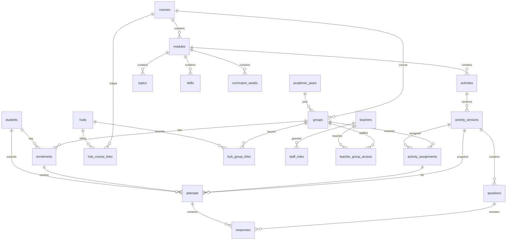

# 04 — Database architecture

The database is the backend. `learning-platform-backend` has no application server. Inspected tree: branch `chore/publish-tlevel-week7-0.4.47`, 103 migrations in `supabase/migrations/`, Postgres 17 in `supabase/config.toml`. The hosted database was not queried. If a hosted timestamp differs from a filename, the filename order in git is what this document describes.

`docs/migrations.md` in that repository says the first 18 migrations were copied from `tlevel-software-development-hub` and must not be renamed. They run from `20260809000100_create_learning_identity.sql` through `20260810213000_secure_learner_onboarding.sql`. One rollback file exists and is not applied automatically: `supabase/rollbacks/20260913180000_admin_hub_learning_results.down.sql`.

## Schemas

| Schema | Created in | Who may use it |
| --- | --- | --- |
| `learning` | `20260809000100_create_learning_identity.sql` | Tables revoked from `anon` and, for sensitive data, from direct browser DML. `authenticated` has `USAGE`. Access is RLS plus grants. |
| `api` | same migration | Data API. Hubs. `USAGE` for `anon` and `authenticated` from `20260811090000_create_platform_foundations.sql`. |
| `platform` | `20260811090000_create_platform_foundations.sql` | Hubs, staff roles, publications, audit. `USAGE` for `authenticated`. |
| `admin_api` | same file | Data API. Portal. `USAGE` for `authenticated`. |
| `library` | `20260818090000_create_content_library.sql` | Authoring objects. `USAGE` for `authenticated`. Direct DML was revoked from `authenticated` in `20260830190200_revoke_library_table_dml.sql`. Writes go through definer RPCs. |

Not created here: `auth` (Supabase), `extensions`, and conditionally `realtime.messages`. No `CREATE TABLE` in `public` was found. There is no `profiles` table, no `units` table, and no progress table.

`api.my_profile` is a view over `learning.students`. Diagnostic “unit” is the text column `unit_key`.

## Entity relationships



All of these tables are in schema `learning` except `hubs`, `hub_course_links`, `hub_group_links` and `staff_roles`, which are in `platform`.

### Learner → enrolment → group → course → module → activity

There is no `units` table between course and activity. The chain in the foreign keys is:

1. `learning.students.id` ← `learning.enrolments.student_id` (`ON DELETE RESTRICT`).
2. `learning.enrolments.group_id` → `learning.groups.id`.
3. `learning.groups.course_id` → `learning.courses.id`, and `learning.groups.academic_year_id` → `learning.academic_years.id`.
4. `learning.modules.course_id` → `learning.courses.id`.
5. `learning.activities.module_id` → `learning.modules.id`. `activities.stable_key` is unique.
6. `learning.activity_versions.activity_id` → `learning.activities.id`. Unique `(activity_id, version)` and `(activity_id, content_hash)`.
7. `learning.activity_assignments` ties a **group** to an **activity version**. Unique `(group_id, activity_version_id)`.

`learning.curriculum_weeks.module_id` → `modules`. `learning.activity_delivery` can point at a version, an academic year, an optional group, and `curriculum_week_id`.

Hubs attach in two different ways:

- `platform.hub_course_links` `(hub_id, course_id)` says which course a hub teaches.
- `platform.hub_group_links` `(hub_id, group_id)` says which teaching groups that hub may enrol and report. Join policy check: `open_auto`, `open_explicit`, `closed`. The hub-learning SQL comment says course links alone would mix hubs that share `ocr-level-3-it`. Reporting uses group links.

A learner can hold more than one active enrolment. The original partial unique index `enrolments_one_active_per_student` was dropped in `20260810085132_enable_multi_course_enrolments.sql`. The live index is `enrolments_one_active_per_student_group` on `(student_id, group_id) WHERE status = 'active'`. Status check: `active`, `completed`, `withdrawn`.

### Activity → attempt → response → progress

1. `learning.attempts` references `student_id`, `enrolment_id`, `assignment_id`, `activity_version_id` (all `RESTRICT`). Unique `(student_id, client_attempt_id)` and `(student_id, assignment_id, attempt_number)`.
2. `learning.responses.attempt_id` → `attempts` `ON DELETE CASCADE`. `question_id` → `learning.questions` `RESTRICT`. Unique `(attempt_id, question_id)`.
3. Progress is not stored. `api.my_activity_progress` is a view (recreated in `20260809000700_extend_learning_api.sql`). `api.my_hub_activity_progress(text)` is a function (latest body in `20260910140000_reporting_current_assignment_membership.sql`) that returns one row per current assignment, completed attempts only, using `learning.current_activity_assignment_id`.

`learning.activity_states` is a draft document for an in-progress activity, unique `(student_id, activity_version_id)`. It is not the progress ledger. `learning.formative_checks` stores server-marked practice checks and is append-only. The hub-results function comment says formative checks affect completion display, not official assignment scores.

Historical attempts keep `activity_version_id`. Publishing a later package does not rewrite old attempts. Published versions are protected by triggers (`activity_versions_immutable_after_publication` and the question, topic, skill, language and marking triggers).

### Other tables an engineer will meet

| Group | Tables |
| --- | --- |
| Identity | `learning.academic_years`, `courses`, `groups`, `students`, `teachers`, `enrolments`, `teacher_group_access` |
| Catalogue | `modules`, `topics`, `skills`, `curriculum_weeks`, `activities`, `activity_versions`, `questions`, `question_topics`, `question_skills`, `coding_languages`, `activity_version_languages`, `question_marking` |
| Delivery | `activity_assignments`, `activity_delivery` |
| Evidence | `attempts`, `responses`, `activity_states`, `formative_checks` |
| Diagnostics | `diagnostic_sessions`, `diagnostic_responses`, `diagnostic_question_marking` |
| Platform | `platform.hubs`, `hub_course_links`, `hub_group_links`, `contract_versions`, `staff_roles`, `audit_events`, `operational_health`, `curriculum_publications`, `curriculum_drafts`, `admin_bootstrap_credentials` |
| Classroom grouping | `learning.grouping_sessions`, `grouping_teams`, `grouping_participants` |
| Knowledge reports | `knowledge_report_content_reviews`, `knowledge_report_standard_evidence`, `knowledge_report_test_clock` |
| Synthetic QA | `synthetic_qa_fixtures`, `synthetic_qa_smoke_activities` |
| Library | 18 `library.*` tables from `20260818090000_create_content_library.sql` and `20260818100000_create_composition_engine.sql` (`questions`, `activities`, `templates`, `resources`, `feedback`, `hints`, composition references, templates, `curriculum_recipes`, and the link tables) |

64 tables were identified. None of the migrations that were searched drop a table after creating it. Inline `REFERENCES` do not set a constraint name. Postgres names those foreign keys. Named constraints in the SQL are the `constraint <name>` checks, such as `enrolment_status_valid` and `groups_synthetic_purpose_required`.

`learning.students.auth_user_id` → `auth.users` `ON DELETE SET NULL`. `student_number` is unique. Partial unique index `students_auth_user_unique`. Teachers mirror that shape with `staff_reference`.

`platform.staff_roles.role` check: `platform_admin`, `curriculum_admin`, `operations`, `auditor`, `support`. Partial unique `staff_roles_one_active_role` on `(teacher_id, role) WHERE revoked_at IS NULL`.

`platform.hubs.hub_code` is unique. Status check: `planned`, `development`, `testing`, `production`, `maintenance`, `deprecated`, `archived`.

`platform.curriculum_publications` unique `(hub_code, course_key, package_version)`, status `published` or `superseded`. Package jsonb is limited (the migration states a 4 MiB check). `platform.curriculum_drafts.lifecycle_status` is `draft`, `ready-for-review`, `in-review`, `approved`.

Every application table found has RLS enabled. Tables with RLS and **no policy** (default deny for `authenticated`): `learning.question_marking`, `learning.diagnostic_question_marking`, `learning.knowledge_report_content_reviews`, `learning.knowledge_report_standard_evidence`, `learning.knowledge_report_test_clock`, `platform.admin_bootstrap_credentials`. Several of those also `REVOKE ALL` from `anon` and `authenticated`.

## Views

59 views were identified. The ones inspected are created `WITH (security_invoker = true)`, or altered to that in `20260818120100_fix_library_view_security_invoker.sql`. None of those definitions use security definer.

**`api` (hubs).** `my_profile`, `my_enrolments`, `my_assignments`, `my_activity_delivery`, `curriculum_weeks`, `my_attempts`, `my_responses`, `my_activity_progress`, and the `teacher_group_*` analytics views (`teacher_group_attempts`, `teacher_group_learners`, `teacher_group_responses`, `teacher_group_topic_analytics`, `teacher_group_question_analytics`, `teacher_group_activity_analytics`, `teacher_group_student_progress`). Hub-scoped assignment and progress reads are functions: `api.my_hub_assignments`, `api.my_hub_activity_progress`.

**`admin_api` (portal).** Listed in [03 Backend integration](03_BACKEND_INTEGRATION.md). Staff read models that were opened include an explicit `WHERE (select platform.current_staff_has_role('platform_admin'))`.

## Functions that carry business rules

199 functions remain after later `CREATE OR REPLACE` and `DROP FUNCTION` in the inspected migrations. `search_path` is `''` on the functions quoted below. Grants below are the `GRANT` / `REVOKE` written in SQL. A `DO` loop grants the grouping functions. That loop is easy to miss in a static search.

Business rules live in Postgres because every hub and the portal must share them, and because the browser key is publishable. The backend architecture document states that identity, enrolment, evidence and RLS are authoritative in Supabase. The code matches that for submission and publication. The portal still duplicates some authoring validation with `@learning-platform/content` before it calls `publish_curriculum`. The database function `platform.validate_curriculum_package` runs again on publish. Both layers exist.

### `api.submit_attempt`

Latest body: `20260923120000_timed_knowledge_report.sql`. The 4-argument function from `20260809000500_create_learning_api.sql` was dropped in `20260809000700_extend_learning_api.sql`.

```text
api.submit_attempt(
  p_activity_key text,
  p_activity_version text,
  p_client_attempt_id text,
  p_responses jsonb,
  p_source_page text default null,
  p_started_at timestamptz default null,
  p_completed_at timestamptz default null,
  p_programming_language text default null
) returns table (
  attempt_id uuid, client_attempt_id text, activity_key text,
  activity_version text, attempt_number integer,
  score numeric, max_score numeric, marking_source text,
  evidence_level text, client_started_at timestamptz,
  client_completed_at timestamptz, source_page text,
  programming_language text, received_at timestamptz,
  idempotent boolean
)
```

`SECURITY DEFINER`. Execute revoked from `public` and `anon`, granted to `authenticated` (grants are on the earlier signature migration and were not re-read line by line on every later replace; a replace keeps the same argument types, so the grant remains). Calling applications: Core `createLearnerApi.submitAttempt`, and the classic facades in Unit 3 and T Level.

Tables touched include `learning.students`, `enrolments`, `groups`, `activity_assignments`, `activity_versions`, `activities`, `questions`, `attempts`, `responses`, language link tables, and `learning.score_submitted_item`.

Rules visible in the function and in `learning.score_submitted_item` (`20260831010000_ignore_client_marks_without_specs.sql`):

- Identity is `auth.uid()`. The payload has no student id.
- Client `awarded_score` and `is_correct` are not applied. Marking goes through `learning.mark_evidence_response` (latest body referenced from `20260924231428_question_structure_fingerprint_marking.sql`).
- A repeated `client_attempt_id` for the same student returns the existing attempt (`idempotent`).
- Exactly one matching active assignment. Zero raises `ACTIVITY_NOT_ASSIGNED`. More than one raises `ACTIVITY_ASSIGNMENT_AMBIGUOUS`.
- Timed knowledge-report submissions are enriched after the idempotency hash.

Raises include `AUTHENTICATION_REQUIRED`, `INVALID_CLIENT_ATTEMPT_ID`, `INVALID_RESPONSES`, `INVALID_CLIENT_TIMESTAMPS`, `INVALID_SOURCE_PAGE`, `STUDENT_IDENTITY_NOT_FOUND`, `CLIENT_ATTEMPT_ID_CONFLICT`, `INVALID_ACTIVITY_VERSION`, `PROGRAMMING_LANGUAGE_NOT_APPLICABLE`, `INVALID_PROGRAMMING_LANGUAGE`, `ACTIVITY_NOT_ASSIGNED`, `ACTIVITY_ASSIGNMENT_AMBIGUOUS`, `INCOMPLETE_RESPONSE_SET`.

`README.md` in the backend still says client marks are accepted when no marking spec exists. `docs/api.md` and the `20260831010000` function say client marks are never applied. Questions with no spec stay pending (`is_correct` null, score 0, `requires_review` true). The README sentence is stale. The function and `docs/api.md` agree.

### Learner and anonymous `api` functions

All `SECURITY DEFINER` with `search_path = ''` unless noted. Execute to `authenticated` after revoke from `public` and `anon`, except where `anon` is listed.

| Function | Latest migration | Execute | Role |
| --- | --- | --- | --- |
| `complete_learner_onboarding(text, text, text, text)` | `20260910120000_complete_onboarding_idempotent_linked.sql` | authenticated | Create or link `learning.students` for `auth.uid()`. Does not choose enrolments |
| `ensure_learner_auth_link()` | `20260910150000_ensure_learner_auth_link.sql` | authenticated | Link when the Auth email matches one active unlinked student |
| `resolve_learner_hub_access(text, text)` | `20260909150000_learner_hub_access.sql` | authenticated | Auto-enrol only for a single eligible `open_auto` group |
| `join_learner_hub_group(text, text)` | `20260909200000_hub_bound_learner_onboarding.sql` | authenticated | Join an `open_explicit` group by class key |
| `my_hub_assignments(text)` | `20260909150000_learner_hub_access.sql` | authenticated | Assignments for groups bound to that hub |
| `my_hub_activity_progress(text)` | `20260910140000_reporting_current_assignment_membership.sql` | authenticated | Progress for current assignments |
| `get_activity_state` / `save_activity_state` / `clear_activity_state` | `20261001154141` and `20260912145840` | authenticated | Drafts. Return includes `revision` |
| `mark_formative_response(text, text, jsonb, text, text)` | `20260907120000` | authenticated | Practice checks into `formative_checks`. Does not write attempts |
| `registered_hubs`, `platform_contract_versions`, `platform_health`, `published_curriculum`, `published_curriculum_package` | foundations and publication migrations | anon and authenticated | Public metadata. Package function raises `PUBLICATION_NOT_FOUND`, `COURSE_NOT_FOUND`, `PUBLICATION_CONTEXT_MISMATCH` |
| `start_diagnostic`, `submit_diagnostic_response`, `complete_diagnostic` | `20260903120000` through `20260905120000` | anon and authenticated | Readiness sittings. `start_diagnostic` does not use `auth.uid()`. Uniqueness index `diagnostic_sessions_one_sitting_idx` |
| `join_grouping_session`, `my_grouping_status` | `20260910160000`, `20260910180000` | anon and authenticated | Classroom join code |

`registration_options()` remains as a compatibility stub that returns no class keys (`20260909200000`).

### Administrative functions

`admin_api` wrappers are often `SECURITY INVOKER` over a `SECURITY DEFINER` `platform.*` function. The grant is to `authenticated`. The role check is inside the definer, not the grant. A signed-in learner can invoke the function. The function is responsible for rejecting them.

| Area | Names | Notes |
| --- | --- | --- |
| Hubs | `register_hub`, `update_hub` | Manifest validation and compatibility trigger `hubs_enforce_compatibility` |
| Curriculum | `publish_curriculum`, `save_curriculum_draft`, `get_curriculum_draft`, `discard_curriculum_draft`, `current_curriculum_package`, `set_session_visibility` | `platform.require_curriculum_author` and `validate_curriculum_package` |
| Review | `review_response` | Updates marks and feedback, sets `learning.allow_teacher_review`, does not replace the payload |
| Hub results | `list_hub_learning_result_filters`, `list_hub_learning_results`, `summarise_hub_learning_results`, `list_hub_learning_result_evidence` | `learning.staff_can_read_hub_results`. Helpers revoked from `authenticated` |
| Library | `search_library`, save/publish/archive/duplicate question and activity, composition and recipe functions | `library.is_content_author()` → `platform_admin` or `curriculum_admin` |
| Grouping | `create_grouping_session(text, integer, text)` and the session/team/participant functions | `platform.require_grouping_platform_admin` on the staff side. Granted to `authenticated` and `service_role` inside a `DO` loop |
| Bootstrap | `claim_initial_platform_admin(text)` | Token hash in `platform.admin_bootstrap_credentials`, which has RLS and no policy |
| Synthetic QA | `ensure_synthetic_qa_groups`, `provision_synthetic_qa_learner`, inspect helpers | `admin_api` wrappers granted to `authenticated`. `learning.*` copies revoked |

`platform.record_audit_event` and `platform.record_operational_health` are granted to `service_role` only.

### Triggers that enforce integrity

| Trigger | Table | Function |
| --- | --- | --- |
| `attempts_validate_integrity` | `learning.attempts` | `learning.validate_attempt_integrity` |
| `attempts_prevent_completed_mutation` | `learning.attempts` | `learning.prevent_completed_attempt_mutation` |
| `attempts_complete_activity_state` | `learning.attempts` | `learning.complete_activity_state_for_attempt` |
| `responses_validate_integrity` | `learning.responses` | `learning.validate_response_integrity` |
| `responses_prevent_completed_mutation` | `learning.responses` | `learning.prevent_completed_response_mutation` |
| `activity_versions_immutable_after_publication` | `learning.activity_versions` | `learning.reject_published_activity_version_change` |
| `questions_immutable_after_publication` and the topic, skill, language and marking equivalents | catalogue children | matching `reject_published_*` functions |
| `question_marking_bind_fingerprint` | `learning.question_marking` | `learning.bind_question_marking_fingerprint` |
| `formative_checks_immutable` | `learning.formative_checks` | `learning.reject_formative_check_mutation` |
| `activity_states_broadcast_invalidation` | `learning.activity_states` | `learning.broadcast_activity_state_invalidation` |
| `activity_assignments_guard_synthetic_qa_smoke` | `learning.activity_assignments` | `learning.guard_synthetic_qa_smoke_assignments` |
| `teachers_reject_synthetic_learner` | `learning.teachers` | `learning.reject_synthetic_learner_staff_role` |
| `hubs_enforce_compatibility` | `platform.hubs` | `platform.enforce_hub_compatibility` |
| `hub_group_links_course_consistent` | `platform.hub_group_links` | `platform.hub_group_link_matches_hub_course` |
| `protect_curriculum_publication` | `platform.curriculum_publications` | `platform.protect_curriculum_publication` |

A search of the migrations did not find `REVOKE` on several trigger functions (`validate_attempt_integrity`, `validate_response_integrity`, `reject_published_activity_version_change`, `reject_published_question_change`, `reject_published_question_topic_change`, and the replaced `prevent_completed_*` functions). In PostgreSQL a new function is executable by `PUBLIC` until revoked. These are trigger functions. They are not granted as a browser API, but the missing revoke is a hardening gap, not proof that a browser can run them usefully. Flagged in [10 Implementation status](10_IMPLEMENTATION_STATUS_AND_ROADMAP.md).

## Indexes that encode rules

- `enrolments_one_active_per_student_group` — one active enrolment per student per group.
- `students_auth_user_unique`, `teachers_auth_user_unique`, `teachers_staff_reference_unique`.
- `staff_roles_one_active_role`.
- `diagnostic_sessions_one_sitting_idx` on `(hub_id, course_id, diagnostic_key, diagnostic_version, student_id)`.
- `hubs_repository_url_unique` on `lower(rtrim(repository_url, '/'))`.
- `question_marking_structure_fingerprint_unique` on `(bound_activity_id, bound_question_key, structure_fingerprint)` where the fingerprint is not null.
- `grouping_participants_session_client_active_uidx` on `(session_id, client_key)` for active rows.
- `activity_delivery_unique_group_schedule`.
- `attempts_admin_recent_completed_idx` (`20260828120000_add_admin_recent_attempts_read.sql`).

Ordinary btree indexes exist on the foreign keys used by attempts, responses and enrolments. They are created in the same migrations as the tables.

## Seeds

`supabase/config.toml` loads, on local `db reset` only:

- `supabase/seed.sql`
- `supabase/data/generated/seed-unit14-publication.sql`
- `supabase/data/generated/seed-unit3-publication.sql`
- `supabase/data/generated/seed-tlevel-publication.sql`

`supabase/seed.sql` inserts synthetic `auth.users` with `.invalid` emails and a null `encrypted_password`, then academic years, groups, students, teachers, enrolments, one platform-admin role, demonstration attempts, Unit 3 delivery rows, draft hubs and health rows. Later migrations also insert catalogue rows (Unit 3 batches, Unit 14, L2E, readiness, T Level Week 7 in `20261105220000_publish_tlevel_week7_0_4_47.sql`). Those are data migrations, not seed files.

## Tests present, not executed

62 SQL tests under `supabase/tests/database` (31), `supabase/tests/api` (29), `supabase/tests/rls` (`platform_admin_rls.test.sql`), and `supabase/tests/integration` (`multi_course_submission.test.sql`). The command is `supabase test db`. `npm test` in the backend runs `scripts/ops/tests/*.test.mjs` only.

## Documentation drift

| Document | What the migrations show |
| --- | --- |
| Backend `README.md` learner API list | Shorter than `docs/api.md`. Migrations match `docs/api.md` (hub assignments, activity state, formative marking, published curriculum, grouping). |
| Backend `README.md` admin mutations | Says mutations other than hub register, hub update and curriculum publication remain unspecified. Migrations also implement review, library, drafts, visibility, synthetic QA, grouping, knowledge-report review and hub-learning RPCs. |
| `docs/database.md` table list | Does not list the knowledge-report tables. Those tables are in migrations and in `docs/migrations.md`. |
| `docs/rls.md` “version 0.1.0” | Says learner-domain admin views are `platform_admin` only. That remains true of the views. Hub-learning RPCs also allow a teacher of a hub-bound group. |

Column-level detail for a table is the latest `CREATE` or `ALTER` in `supabase/migrations/`. This document names the objects and the rules that change how the portal and the hubs behave. It is not a substitute for reading the migration when changing a column.
