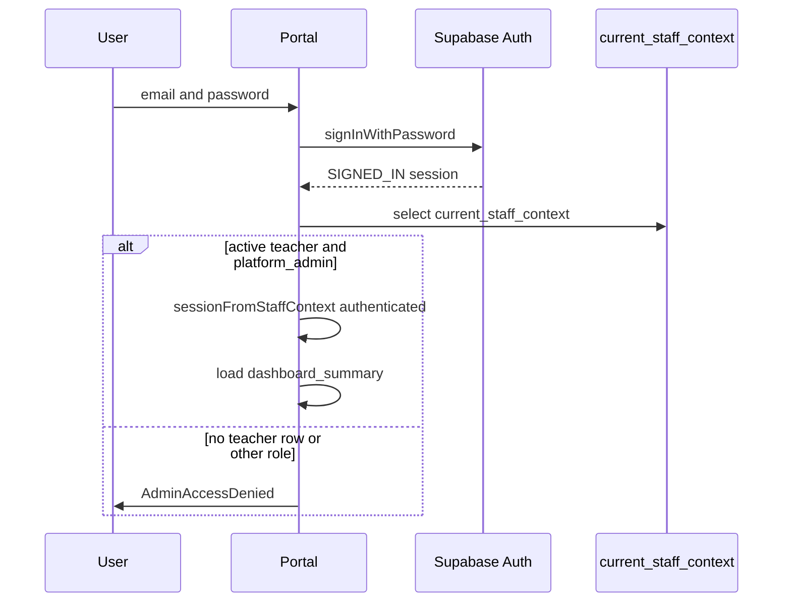

# 05 — Authentication and security

Two different clients share one Supabase Auth project. Staff open the Admin Portal, which calls `admin_api`. Learners open a hub, which calls `api`. A session cookie or `localStorage` token from one hub does not, by itself, open the portal. The portal asks `admin_api.current_staff_context` whether `auth.uid()` is an active teacher with `platform_admin`.

The frontend gate and the database gate are both real. They are not the same check. The database check is the one that still applies if someone calls PostgREST directly.

## 5.1 Authentication

### Staff (Admin Portal)

Configuration is in `createSupabaseAdminClient` (`src/services/supabase-admin-service.ts`):

- PKCE (`flowType: "pkce"`).
- Session persistence and automatic refresh (`persistSession`, `autoRefreshToken`).
- `detectSessionInUrl` so a magic-link or recovery redirect can be read.
- Schema fixed to `admin_api`.

| Step | Implementation |
| --- | --- |
| Sign-in | `AdminSignIn` → `signInAdminWithPassword` → `auth.signInWithPassword`. Optional magic link: `signInWithOtp` with `shouldCreateUser: false`. |
| Restore | `onAuthStateChange`. Bootstrap runs for `INITIAL_SESSION` and `SIGNED_IN` only (`shouldBootstrapAdminData` in `src/stores/admin-portal-auth.ts`). |
| Refresh | The Supabase client refreshes the JWT. `refresh` on the portal calls `getSession` and bootstraps again. |
| Recovery | Hash or query may contain `token_hash` and `type=recovery`. Pages moves those parameters onto the search string (`applyAdminAuthCallbackLocation`). The UI shows Continue. Only then `verifyOtp`. `updateUser({ password })` sets the password. That recovery session does not load admin data. |
| Sign-out | `auth.signOut`, then cleared portal state. A cancelled recovery verify also signs out. |
| Unauthenticated UI | Status `signed-out` renders `AdminSignIn`. No module loader runs. |
| Protected routes | There is no router guard per path. `AdminPortalFrame` renders the shell only when status is `ready`. |

`registerAdminAccount` (`auth.signUp`) exists and is covered by `tests/integration.test.ts`. The sign-in screen does not expose it. `docs/permissions.md` says the first administrator is created with privileged SQL, not this UI. `claim_initial_platform_admin` matches that second path and is also absent from the screen. The bootstrap token is stored as a hash in `platform.admin_bootstrap_credentials`. The table has RLS and no policy.

Password reset that fails for a reason other than the network still shows the generic “if an account exists” message (`requestAdminPasswordReset`). That is intentional in the client so the form does not reveal whether the email is registered.

### Learners (hubs)

Hubs call `createSupabaseClient` and `createPlatform` from `@learning-platform/core` (`src/platform.ts` in each React hub). Auth is `createAuthService` (`learning-platform-core/src/core/auth/auth-service.js`): `initialise`, `signIn`, `signUp`, `signOut`, `refreshSession`, `subscribe`.

`createAuthStorageKey(projectUrl, hubCode)` scopes storage to the hub. A Cyber Security session does not sign the learner into T Level. Emerging Digital Technologies only detects a sibling token (`src/sibling-hub-session.ts`). It does not import it.

After `getSession`, the hub calls `learner.refresh()` and, if the profile probe raced the session, `recoverLearnerAfterAuthRestore()`. Onboarding RPCs then link `learning.students.auth_user_id` to `auth.uid()` (`complete_learner_onboarding`, `ensure_learner_auth_link`). Enrolment is a later RPC (`resolve_learner_hub_access`, `join_learner_hub_group`).

The readiness diagnostic and the classroom group generator also call RPCs as `anon`. Those flows do not establish a staff session. Diagnostic sessions store a reported `student_id` string. The migration comment and the function say `start_diagnostic` does not take `auth.uid()`.

### What a session is not

The portal does not store roles in `localStorage`. `tests/admin-auth.test.ts` asserts that writing local storage cannot grant access. The recovery flag `lp-admin-password-recovery` is a flow flag. Role labels on the shell are `active_roles` with underscores replaced by spaces. They are display text.

## 5.2 Authorisation

### Where roles live

| Fact | Store |
| --- | --- |
| Auth identity | `auth.users`, exposed as `auth.uid()` |
| Learner profile | `learning.students` where `auth_user_id = auth.uid()`, via `learning.current_student_id()` |
| Staff profile | `learning.teachers` where `auth_user_id = auth.uid()`, via `learning.current_teacher_id()` |
| Platform role | `platform.staff_roles` (`platform_admin`, `curriculum_admin`, `operations`, `auditor`, `support`) while `revoked_at` is null |
| Teaching-group role | `learning.teacher_group_access.role` (`teacher`, `lead`, `viewer`) and `learning.teacher_can_access_group` |

A person can be a learner and a teacher only if both rows share an Auth user. A trigger `teachers_reject_synthetic_learner` blocks synthetic QA learners from gaining a teacher row.

### What the portal allows

`sessionFromStaffContext` (`src/stores/admin-session.ts`) grants `grantedActions: ["*"]` only when the context is active and `activeRoles` includes `platform_admin`. Every other authenticated user, including staff whose only role is `curriculum_admin`, gets `access-denied`.

`canAccess(session, capability)` would honour `*` or a named capability. Nothing calls it. Module `capability` strings in `src/router/modules.ts` do not filter navigation.

So the portal does not distinguish teachers from administrators inside the shell. Either the user is an active platform administrator, or the shell does not render. Finer roles exist in the database and on some RPCs.

### What the database allows beyond the shell

| Operation | Rule in SQL |
| --- | --- |
| `admin_api` learner, group, attempt and results **views** inspected | `WHERE (select platform.current_staff_has_role('platform_admin'))` |
| `current_staff_context` | Own teacher row only |
| Library and composition RPCs | `library.is_content_author()` → `platform_admin` or `curriculum_admin` |
| Hub-learning result RPCs | `learning.staff_can_read_hub_results`: `platform_admin` or `teacher_can_access_group` on an active hub-bound group |
| Learner attempts | `api.submit_attempt` uses `auth.uid()` → `learning.students`. It does not accept a student id argument |
| Teacher group views in `api` | `learning.teacher_can_access_group` |
| Public catalogue and health | `anon` may execute the published-curriculum and health functions listed in [04 Database architecture](04_DATABASE_ARCHITECTURE.md) |

Group and course scope for reporting is `platform.hub_group_links` plus enrolments, not a claim in the JWT.

## 5.3 Database security

### `auth.uid()`

`learning.current_student_id()` and `learning.current_teacher_id()` resolve the profile row for `auth.uid()`. Views and definer functions call those helpers. Submission, onboarding and activity-state RPCs refuse to run without a user (`AUTHENTICATION_REQUIRED` or `AUTH_REQUIRED`).

`start_diagnostic` is the deliberate exception among learning records: the sitting is anonymous and keyed by the reported student label plus diagnostic version. Staff read those rows only through `admin_api` views that require `platform_admin` (RLS on `diagnostic_sessions` and `diagnostic_responses` is `platform_admin` only, and `anon` has no `SELECT`).

### RLS

Policies found are permissive and combine with `OR`. Almost every policy is `FOR SELECT TO authenticated`. Direct DML grants are revoked on sensitive tables, so an insert policy is not enough to write. The write path is a security-definer function.

Learner and teacher read policies from `20260809000400_create_learning_rls.sql`, plus a second `platform_admin` select policy from `20260811090000_create_platform_foundations.sql`:

| Policy pattern | Predicate |
| --- | --- |
| Catalogue (`academic_years`, `courses`, `modules`, `topics`, `skills`, `activities`, `coding_languages`) | `active` |
| `activity_versions` | published and not retired |
| Questions and their topic, skill and language links | parent version published and not retired |
| `groups`, `enrolments`, `activity_assignments` | active enrolment for `current_student_id()`, or `teacher_can_access_group` |
| `students` | own row, or a student in a group the teacher can access |
| `teachers` | own row |
| `teacher_group_access` | own `teacher_id` |
| `attempts` and `responses` | own `student_id`, or teacher access through the enrolment’s group |
| `activity_states` | `FOR ALL` to `authenticated` and `anon` with `USING (false)` — no direct read |
| `formative_checks` | not a student, and platform admin or a teacher of the assignment’s group |
| Diagnostic and grouping tables | `platform_admin` only |
| `platform.hubs` and contracts | any staff role including `support` |
| Hub links | staff roles except `support` |
| `staff_roles` | own teacher id, or `platform_admin` |
| `audit_events` | `platform_admin`, `operations`, `auditor` |
| `operational_health` | `platform_admin`, `operations`, `support` |
| `curriculum_publications` | `platform_admin`, `curriculum_admin`, `operations`, `auditor` |
| `curriculum_drafts` | `platform_admin` or `curriculum_admin` |
| `library.*` | `library.is_content_author()` for select. Insert/update/delete policies exist and the table DML grant was later revoked |

Realtime: if `realtime.messages` exists, `learner_receive_own_activity_state_broadcast` allows `authenticated` to select broadcasts whose topic is `learner-state:` plus `auth.uid()`.

### Security definer

`api.submit_attempt`, onboarding, hub access, formative marking, publication, hub registration, review, grouping and hub-learning results run as the function owner and then apply their own checks. `search_path` is empty on the bodies that were opened, which blocks unqualified-name tricks.

`admin_api` wrappers that are `SECURITY INVOKER` do not bypass RLS by themselves. They call a definer in `platform` or `learning` that does. Invoker views do not bypass RLS. Their extra `WHERE current_staff_has_role('platform_admin')` is what makes a learner’s own RLS policy insufficient: the learner might satisfy `students_actor_scoped_read` for their own row, and the view still returns nothing because the staff predicate is false.

### Credentials

| Secret | Where it is allowed |
| --- | --- |
| Publishable / anon key | Browser apps. The portal rejects keys that are not publishable or anon JWTs (`isBrowserSafeSupabaseKey`). |
| Service-role key | Backend ops scripts. Names in `learning-platform-backend/.env.example`: `SUPABASE_URL`, `SUPABASE_SERVICE_ROLE_KEY`. The portal has no service-role variable. |
| Bootstrap token | Hashed in `platform.admin_bootstrap_credentials`. Not a browser setting. |
| Grouping join codes | Six characters from a restricted alphabet. Knowing a code joins a classroom session as `anon`. It does not grant `admin_api`. |

GitHub Actions for the portal maps repository variables `ADMIN_DATA_MODE`, `SUPABASE_URL` and `SUPABASE_PUBLISHABLE_KEY` into `NEXT_PUBLIC_*` at build time. Those values are baked into the static bundle. That is normal for a publishable key and unsafe for a service-role key. The client-side reject is the guard if the wrong key is pasted into `.env.local`. The Pages build does not run that check before embedding the variable. Operators must put the publishable key in the Actions variable.

## 5.4 Scenarios

### 1. A learner opens the Admin Portal

They can load the static site. `signInWithPassword` succeeds if they have an Auth user. `current_staff_context` returns no row, because `current_teacher_id()` is null. `sessionFromStaffContext` sets `access-denied`. The shell does not mount, so the learner list is not requested.

If they call `admin_api.learners` with their JWT anyway, the view’s `WHERE platform.current_staff_has_role('platform_admin')` is false. The view is `security_invoker`. RLS on `learning.students` would also hide other learners. The staff predicate is what hides their own row from this view.

This behaviour is what `tests/integration.test.ts` and `tests/architecture.test.mjs` describe (learner and non-admin denied; no email-domain role check). The tests were not executed for this document.

### 2. A teacher opens an unauthorised group

Inside the portal this case does not arise for a teacher who lacks `platform_admin`: the shell never loads.

A teacher who **is** `platform_admin` can read every group the admin views return. The views do not filter by `teacher_group_access`. Platform admin is global in those SQL predicates.

A teacher who is **not** a platform admin can still call `admin_api.list_hub_learning_results` directly. `staff_can_read_hub_results` then limits rows to hub-bound groups where `teacher_can_access_group` is true. An unauthorised group is absent from `staff_visible_hub_group_ids`. That RPC path was read in `20260913180000_admin_hub_learning_results.sql`. It was not exercised against a live database here.

`api.teacher_group_*` views use the same group helper for hub-side teacher analytics. The portal does not query those views.

### 3. An unauthenticated user reads learner records

`admin_api` views are granted to `authenticated`, not relied upon as a public API. Without a JWT, PostgREST uses `anon`. The staff views were not granted to `anon` in the statements that were read (`grant select on admin_api.learners to authenticated`).

Anonymous functions that **are** granted: `registered_hubs`, contract and health, published curriculum packages (marking specs stripped), diagnostic start/submit/complete, and grouping join. `published_curriculum_package` raises if the publication is missing. It is documented to omit drafts and marking specs (`strip_learner_answer_keys` is the related helper).

### 4. A user submits data for another learner

`api.submit_attempt` takes activity key, version, client attempt id and responses. There is no student id parameter. The student is `auth.uid()`. A mismatched `client_attempt_id` that already belongs to a different payload raises `CLIENT_ATTEMPT_ID_CONFLICT`. Core’s `assertSecureSubmission` rejects identity fields and mark fields before the call (`learning-platform-core/src/core/security/hub-security-baseline.js`).

The classic Unit 3 and T Level facades call the same RPC and do not pass through that allow-list. They still cannot add a student id the function does not accept. They could send extra JSON keys. The function reads named arguments. Extra keys inside `p_responses` are a marking concern: `mark_formative_response` raises `FORBIDDEN_SUBMISSION_FIELD` for forbidden fields. `submit_attempt` marks through `mark_evidence_response` and ignores client scores.

`review_response` is staff-only in its definer. A learner JWT should fail the staff check. The exact raise code was not copied into this note. The portal sends `p_response_id` only after the platform-admin gate.

### 5. A user bypasses the frontend

Hiding a button does not grant a write. The pending dialogs never send a request, so there is nothing to replay for “create group”.

For operations that do exist, bypass means calling PostgREST with a user JWT:

- View reads still apply the `platform_admin` predicate and RLS.
- Definer RPCs still apply `current_staff_has_role`, `is_content_author`, or `staff_can_read_hub_results`.
- `submit_attempt` still binds `auth.uid()`.
- Direct `INSERT` into `learning.attempts` is not granted. Triggers `attempts_validate_integrity` and `attempts_prevent_completed_mutation` protect rows if a privileged role writes them.

Frontend restrictions are a usability layer. The controls that prevent unauthorised access are the grants, the view predicates, RLS, and the checks inside security-definer functions.

## Security review findings

These are observations from reading SQL and the portal. They are not the result of a penetration test.

| Finding | Evidence | Severity for a review |
| --- | --- | --- |
| Portal role is coarser than the database | Shell requires `platform_admin`. RPCs also allow `curriculum_admin` (library) and group teachers (hub results). | Document the boundary so a future UI does not assume the RPC is admin-only. |
| Some trigger functions have no `REVOKE` from `PUBLIC` | Migrations for `validate_attempt_integrity` and several `reject_published_*` functions. | Hardening. They are not a supported API. Confirm `PUBLIC` execute on the hosted database. |
| Anonymous diagnostic and grouping | `start_diagnostic`, `join_grouping_session` granted to `anon`. | By design. Join codes and diagnostic labels are not Auth. Rate limits were not found in the migrations that were read. |
| Publishable key in the static bundle | Pages workflow injects `NEXT_PUBLIC_SUPABASE_PUBLISHABLE_KEY`. | Expected if the value is the publishable key. Dangerous if a service-role key is stored in that variable. The dev client rejects service-role keys. The CI build does not. |
| CLI baselines embed a project URL and a publishable key | `learning-platform-cli/src/shared/baselines.ts`. | The key is a browser key. Rotating it means updating every generated hub. Not reproduced here. |
| README versus marking | Backend README still describes accepting client marks. The function does not. | Stale documentation can cause a hub to send marks and believe they were stored. |
| Hosted schema not compared | `docs/migrations.md` warns that hosted timestamps can differ. | This review cannot claim the hosted project matches the git migrations until `supabase db` or a schema dump is checked. |
| First-admin claim still callable | `claim_initial_platform_admin` granted to `authenticated`, UI hidden. | Safe only while the stored token hash is unused or rotated. `docs/permissions.md` prefers privileged SQL. |

Tests that encode the portal’s expectations: `tests/admin-auth.test.ts`, `tests/integration.test.ts`, `tests/architecture.test.mjs`. Backend: `supabase/tests/rls/platform_admin_rls.test.sql` and the `supabase/tests/api` submission tests. None were executed while writing this set.

Related: [03 Backend integration](03_BACKEND_INTEGRATION.md), [11 End-to-end workflows](11_END_TO_END_WORKFLOWS.md).
