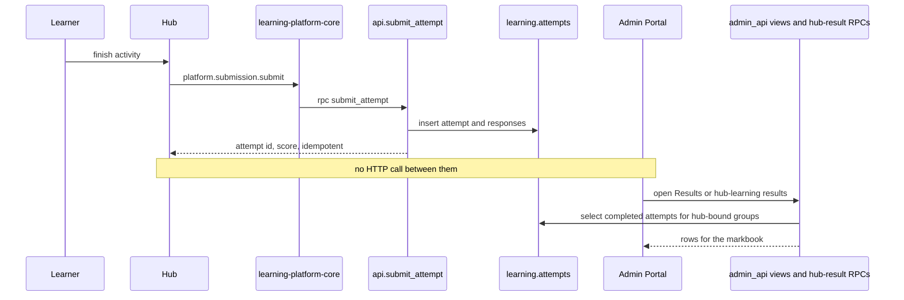

# 06 — Hub integration

Learning hubs are separately deployed sites. They share one Supabase project and the packages `@learning-platform/core`, `@learning-platform/content` and `@learning-platform/ui`. They do not import the Admin Portal and they do not fetch its GitHub Pages URL. A search of the hub trees found no runtime call to `learning-platform-admin`.

Information reaches the portal because both sides read and write the same database. The hub calls schema `api`. PostgreSQL stores attempts and responses. The portal calls schema `admin_api`, whose views and RPCs read those tables.

The example below is the implemented catalogue finish for Unit 3 activity `u3-w01-baseline`. Classic pages in the same hub can still call the same RPC through a second client. Both paths are described.

## 6.1 Hub inventory

Versions are the local `package.json` / `src/config.ts` on the branch that was read. CI pins are in each `.github/workflows/pages.yml` and in [01 System overview](01_SYSTEM_OVERVIEW.md).

### Cyber Security Hub

| | |
| --- | --- |
| Repository | `unit-3-Cyber-Security-Hub` |
| Branch read | `fix/week6-published-revision-organiser` |
| Package | `unit-3-cyber-security-hub` 0.2.1 |
| Hub id | `unit-3-cyber-security`. Course key `ocr-level-3-it` |
| Entry | `src/main.tsx` from each route HTML. `index.html` loads `./src/main.tsx` |
| Stack | Vite 6.3.5, React 19.2.6, TypeScript 5.9.3, `@supabase/supabase-js` 2.112.3 |
| Platform wiring | `src/platform.ts` `createHubPlatform` → `createSupabaseClient` from `@learning-platform/core/advanced` → `createPlatform` |
| Curriculum | `content/unit-3-cyber-security/package.json` (content package version 0.2.0). Activity ids such as `u3-w01-baseline` at version `1.3.0`, `u3-w01-cia`, `week2-session1-retrieval`. Slug map: `src/catalogue/week-activities.ts` |
| Auth | Learner email and password through Core. Legacy `js/core/supabase-auth.js` delegates to `window.LearningPlatform.platform` and does not create a second client |
| Deploy | `.github/workflows/pages.yml`. Push to `main` or `unit-3-Cyber-Security-Hub`, plus pull requests. Pins Core `v0.2.27`, Content `v0.1.4`, UI `v0.1.15`. Deploy job publishes `dist` when the event is not a pull request |

`docs/core-integration.md` still says Pages pins Core `v0.2.5` and UI `v0.1.8`, and that the Week 1 catalogue version is `1.2.0`. The workflow and `u3-w01-baseline` at `1.3.0` disagree with that document. `src/formative-contract.ts` refuses to remap `u3-w01-*` onto `1.2.0`.

### T Level Software Development Hub

| | |
| --- | --- |
| Repository | `tlevel-software-development-hub` |
| Branch read | `feat/week-7-curriculum-expansion` |
| Package | `tlevel-software-development-hub` 0.2.0 |
| Hub id | `tlevel-software-development`. Course `t-level-digital-software-development`. Declared `coreVersion` `0.2.26` |
| Entry | `src/main.tsx`. Config is `src/supabase-config.ts` (no `window.SUPABASE_CONFIG` bootstrap) |
| Curriculum | `content/tlevel-software-development/package.json` at `0.4.31` on this branch. Foundations keep HTML routes, for example `foundations-requirements-classification` `1.0.0` and `foundations-programming-diagnostic` `2.0.0`. Week example: `week-7-lesson-1-ex-01` `0.1.0` |
| Auth | Same Core path. `js/core/supabase-learning-api.js` remains as a compatibility facade over the same client |
| Deploy | Pages workflow pins Core `v0.2.26`, Content `v0.1.4`, UI `v0.1.15`. Deploy on non-PR `main` |

`docs/ARCHITECTURE.md` in that hub still describes a framework-free site, Core `0.2.5`, and `js/core/platform.js` as the composition root. The React entry is `src/platform.ts`. `js/core/platform.js` still exists. It is not the Vite entry.

### Emerging Digital Technologies Hub

| | |
| --- | --- |
| Repository | `Emerging-Digital-Technologies-Hub` |
| Branch read | `fix/persist-formative-results` |
| Package name | `l2e-exploring-emerging-digital-technologies` 0.1.0 (the npm name is not the GitHub repo name) |
| Hub id | `l2e-exploring-emerging-digital-technologies`. Course `gateway-level-2-digital-it-skills`. `coreVersion` `0.2.20` |
| Entry | `src/main.tsx` |
| Curriculum | Activities are inline in the content package. Inspected branch has weeks 1–3. Examples, version `0.1.0`: `week-1-digital-technology`, `week-1-current-emerging`, `week-1-welcome`, `week-1-mobile` |
| Auth | Core, plus `src/sibling-hub-session.ts` which only detects another hub’s token |
| Deploy | Pins Core `v0.2.20`, UI `v0.1.11`, Content `v0.1.4` |

The folder `l2e-exploring-emerging-digital-technologies-hub` is another checkout of the same GitHub repository, on a detached commit that still contains weeks 4–8. It is not a second product. Its workflow pins Core `v0.2.26` and UI `v0.1.15`.

### Further hubs

| Repository | Role |
| --- | --- |
| `unit-14-software-engineering-for-business-hub` | Separate Vite hub. Hub id `unit-14-software-engineering-for-business`. Pages workflow. Backend architecture doc classifies it as database-driven curriculum. |
| `level-3-it-year-1-readiness-hub` | Induction diagnostic. Hub id `level-3-it-year-1-readiness`. `src/diagnostic/api-client.ts` calls `start_diagnostic`, `submit_diagnostic_response`, `complete_diagnostic`. `src/platform.ts` still calls `createPlatform`. README says there is no login. The platform file still receives Supabase config. Treat the README and `src/platform.ts` as a discrepancy until a runtime check confirms which path the sitting uses. |

Shared `src/` shape on the three primary hubs: `pages/`, `hooks/useHubPlatform.ts`, `platform.ts`, `content/` or `curriculum/`, and `components/`. Unit 3 and T Level also have `js/core/` facades and `adapters/`.

## 6.2 Activity lifecycle

Core refuses any schema other than `api` (`createLearnerApi` in `learning-platform-core/src/core/api/learner-api.js`). The RPCs that client exposes include `submit_attempt`, `mark_formative_response`, `save_activity_state`, `get_activity_state`, `resolve_learner_hub_access`, `complete_learner_onboarding` and `published_curriculum_package`.

### Catalogue finish — `u3-w01-baseline`

1. `week-1/baseline/index.html` loads `src/main.tsx`.
2. `useHubPlatform` → `createHubPlatform` → `platform.initialise()` restores the Auth session.
3. `src/pages/ActivityPage.tsx` loads activity `u3-w01-baseline` version `1.3.0` from the content package. `cataloguePlayerMode` selects the React player unless the id is in `WEEK_HOST_ACTIVITY_IDS` or `WEEK_HYBRID_ACTIVITY_IDS`. `week6-revision-organiser` is a host activity and does not use this player.
4. Each Check uses `@learning-platform/ui` `createMarkResponseHandler` → `platform.marking.markBlock`. Unit 3 `resolveFormativeContract` (`src/formative-contract.ts`) keeps the `u3-w01-*` question id and the package version. Core calls `rpc("mark_formative_response", { p_activity_key, p_activity_version, p_responses, p_client_check_id, p_source_page })`. That writes `learning.formative_checks`, not an attempt. `tests/check-does-not-submit-attempt.test.js` asserts Check does not call `submit_attempt`.
5. `finishActivity` calls `submitCatalogueDraft` (`src/catalogue/activity-draft.ts`).
6. `platform.submission.submit({ activityKey, activityVersion, responses, sourcePage, startedAt, completedAt })`.
7. `createSubmissionService.submit` (`learning-platform-core/src/core/submission/submission-service.js`) builds the payload and calls `api.submitAttempt`.
8. PostgREST: `client.schema("api").rpc("submit_attempt", payload)`.

Payload fields:

| RPC argument | Source |
| --- | --- |
| `p_activity_key` | `activityKey` |
| `p_activity_version` | `activityVersion` (`canonicalActivityVersion` / `resolveActivityVersion` in Core) |
| `p_client_attempt_id` | Generated client id, stable for retries |
| `p_responses` | `{ question_id, response_type, response_payload }` from `toApiResponse` |
| `p_source_page` | Page path |
| `p_started_at`, `p_completed_at` | Client timestamps |
| `p_programming_language` | Null unless the activity supplies one |

Caller fields allowed before mapping: `activityKey`, `activityVersion`, `clientAttemptId`, `responses`, `sourcePage`, `startedAt`, `completedAt`, `programmingLanguage`. Identity and scores are rejected by `assertSecureSubmission`.

9. `api.submit_attempt` resolves `auth.uid()` to `learning.students`, requires one active assignment for that activity version, marks on the server, and inserts `learning.attempts` and `learning.responses`. A repeat of the same client attempt id returns the stored row (`idempotent`).
10. On success, `ActivityPage` calls `Unit3BackendProgress.reconcile` (`js/core/backend-progress.js`) → `platform.progress.getProgress()` → view `api.my_activity_progress`.

Drafts use `platform.progress.createStore` → `get_activity_state` / `save_activity_state` / `clear_activity_state`. An insert into `learning.attempts` fires `attempts_complete_activity_state`, which completes the draft.

### Second submit path in Unit 3

Still loaded from `sharedAdapters`:

- `js/core/unit3-supabase-submit-runner.js` `submit`
- `js/core/supabase-submission-adapter.js` `buildRpcPayload`
- `js/core/supabase-learning-api.js` `submitAttempt`
- the same `rpc("submit_attempt")`

`buildRpcPayload` uses the same `p_*` names. A response may include `response_type` and `chosen_index`. This path does not use Core’s field allow-list. The baseline catalogue page does not use this runner for Finish. `js/core/week1-final-submit.js` is the classic Week 1 adapter into the runner. It does not fall through to the old Apps Script `submitAttempt` after a Supabase failure. Apps Script remains for classic `activities/activity.html`, as described in `js/config/supabase-config.js`.

### T Level

Foundations: `FoundationActivityPage` → `bootFoundationActivity` → `js/activities/activity-engine.js` `submitCurrentResult` → `js/core/learning-api.js` `submitResult` → `supabase-learning-api.js` `rpcPayload`. Responses are `{ question_id, response_payload }` without `response_type`. `canSubmit` requires sign-in and an id in `enabledActivities`.

Week content: `content/engine/submit.js` `submitActivityDraft` → `platform.submission.submit`, with `programmingLanguage: "python"` when the activity has a code block.

Progress for foundations goes through `js/core/supabase-analytics.js` (`getProgress`, `getAttempts`).

### Emerging Digital Technologies

No `supabase-learning-api.js`. `content/engine/interactive.js` listens for `lp-block-result` and, when `detail.completed` is true, calls `submitActivityDraft`. Per-question Check uses `platform.marking.markBlock`. `src/formative-marking.test.ts` shows a classification payload for `week-1-digital-technology` / `0.1.0` with `question_id` `week-1-digital-match:d-iot`. Curriculum load uses `published_curriculum_package`.

### Version handling

The activity key is the catalogue stable id (`u3-w01-baseline`). The version string is the `lp.content` activity version the hub loaded (`1.3.0`). `api.submit_attempt` resolves that pair to `learning.activity_versions`. Unknown pairs raise `INVALID_ACTIVITY_VERSION`. Published rows cannot be edited in place (triggers in [04 Database architecture](04_DATABASE_ARCHITECTURE.md)). A new publication creates a new version. Old attempts keep the version id they were submitted against.

Duplicate submission of the same client attempt id is the idempotent return. A second id is a new attempt number, subject to assignment rules. Formative retry limits are enforced in `mark_formative_response` (`FORMATIVE_RETRY_LIMIT`), not in the attempt function.

### Progress retrieval the hub uses

| Read | Object |
| --- | --- |
| Profile, enrolments, assignments, delivery, attempts, responses, progress | views `api.my_profile`, `my_enrolments`, `my_assignments`, `my_activity_delivery`, `my_attempts`, `my_responses`, `my_activity_progress` |
| Hub-scoped assignments and progress | functions `my_hub_assignments(hub)`, `my_hub_activity_progress(hub)` |
| Weeks | `api.curriculum_weeks` (Unit 3 facade also selects this view) |
| Drafts | `get_activity_state`, `save_activity_state`, `clear_activity_state` |
| Published teaching package | `published_curriculum_package` |

Reports (`learning-platform-reports`) calls `my_hub_activity_progress` from its own client (`src/api/reporting-api.ts`). That call is not on Core’s `createLearnerApi`. Reports is a third reader of the same rows, not a writer.

## 6.3 How the portal sees hub data

The portal does not subscribe to hubs. After a successful `submit_attempt`:

1. `learning.attempts` and `learning.responses` hold the evidence.
2. `admin_api.attempts`, `admin_api.responses`, `admin_api.recent_attempts` and the analytics views select those tables for `platform_admin`.
3. `admin_api.list_hub_learning_results` and `summarise_hub_learning_results` restrict to groups in `platform.hub_group_links` for `p_hub_code`, current enrolments, and `learning.current_activity_assignment_id`.
4. The markbook maps those rows in `src/results/from-admin-snapshot.ts` and interprets them with `@learning-platform/results`.
5. Teacher review calls `admin_api.review_response`, which updates score and feedback on `learning.responses` and sets marking source to the teacher path. It does not replace `response_payload`.

Diagnostic sittings never enter `learning.attempts`. The readiness hub writes `learning.diagnostic_sessions` and `learning.diagnostic_responses`. The portal reads `admin_api.diagnostic_sessions`, `diagnostic_responses` and `diagnostic_summary`.

Classroom grouping writes `learning.grouping_*`. The portal reads them through `get_grouping_session`. Those rows are not teaching groups and do not appear as `learning.groups`.

Shared service modules: the portal uses `@learning-platform/results` to interpret rows it has already loaded. It does not use Core’s learner API. Hubs use Core and do not use the results package.

## 6.4 Cross-hub analytics

| Question | Implemented answer |
| --- | --- |
| Which hub? | `platform.hubs.hub_code`, joined to groups through `platform.hub_group_links`. The hub-learning RPC takes `p_hub_code`. Course links are not sufficient, because Unit 3, Unit 14 and the readiness hub can share `ocr-level-3-it` (comment in `20260913180000_admin_hub_learning_results.sql`). |
| Which learner? | `learning.students.student_number` and `display_name` on the admin views. The browser does not send `learner_id` into `submit_attempt`. |
| Which group? | `learning.groups.code` via the attempt’s assignment, or via the current enrolment in the hub-results function. |
| Which course or module? | `learning.courses.stable_key` on the group. Activities belong to `learning.modules`, not to a unit table. Week and session numbers come from delivery and curriculum week metadata on the hub-results row. |
| When? | `learning.attempts.completed_at` and `received_at`. |
| What was submitted? | `learning.responses.response_payload` through `admin_api.responses` or `list_hub_learning_result_evidence`. |
| How is progress calculated? | Completed attempts against the current assignment (`my_hub_activity_progress`, hub-results SQL). The markbook also runs `createLearnerProgress` in the browser on the attempt snapshot. Formative checks are not official scores. |

Analytics panes (`/analytics`) aggregate with `admin_api.group_performance`, `learner_performance`, `activity_analytics`, `question_performance`, `topic_performance` and `skill_performance`. Topic and skill links are `learning.question_topics` and `learning.question_skills`.

`result-sources.ts` can show L2E, Unit 3, T Level and Unit 14 as hub-learning sources. L3E is an explicit unavailable state: “No L3E hub is registered”. That is an implemented empty state, not a hidden hub.

## Deployment configuration

Each hub’s Pages workflow checks out that hub plus pinned Core, Content and UI, runs `npm ci` and `npm test` (the hub test script includes the Vite build and a learner-bundle check), then deploys `dist` with `actions/deploy-pages` when the event is not a pull request. Vite `base` is `"./"`. Sites are GitHub project pages.

A change to a published curriculum package does not require that workflow. Learners load `api.published_curriculum_package`. A change to React components, a new block type, or Core does require the workflow, and only for the hubs whose pin is updated.

Related: [03 Backend integration](03_BACKEND_INTEGRATION.md), [11 End-to-end workflows](11_END_TO_END_WORKFLOWS.md).
