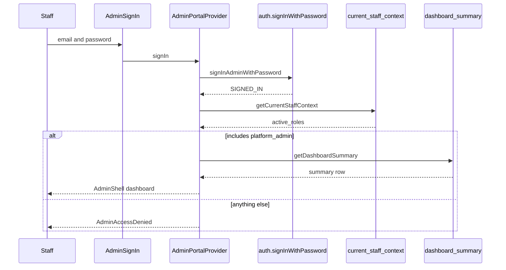
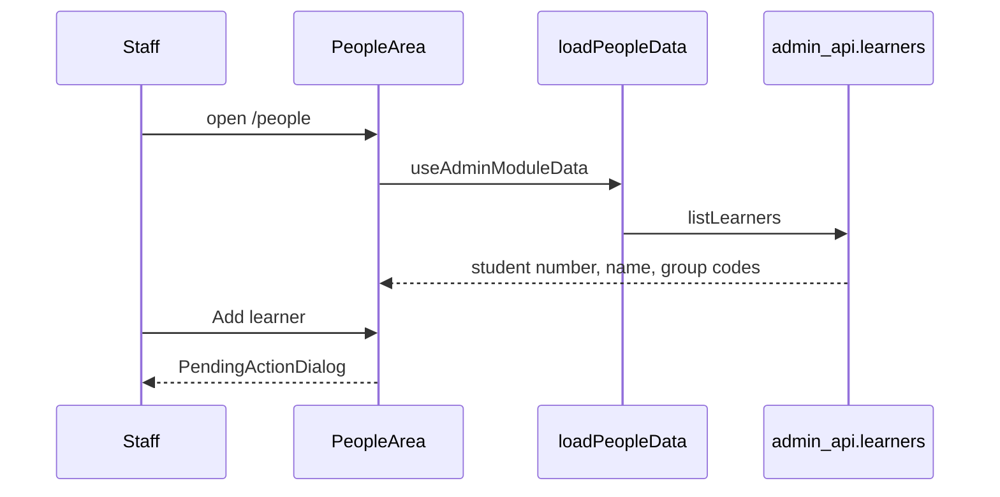
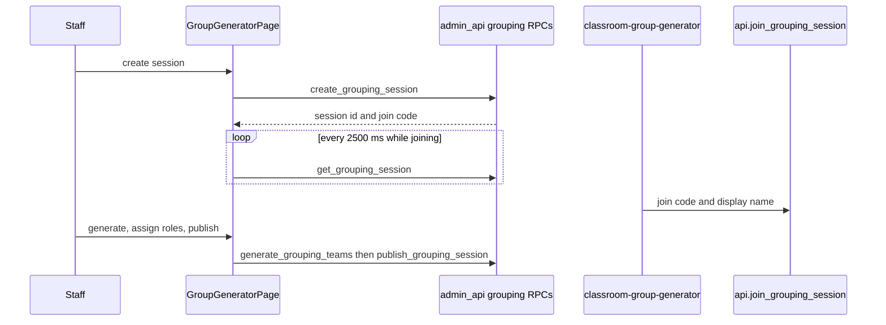
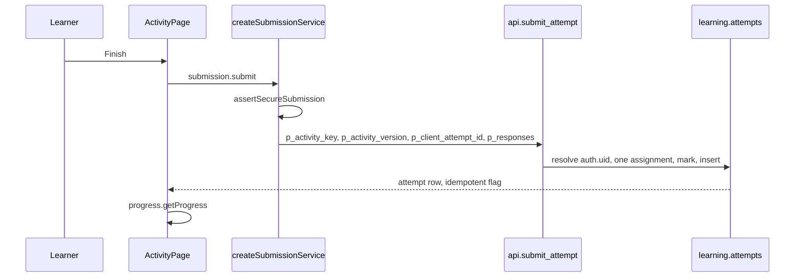
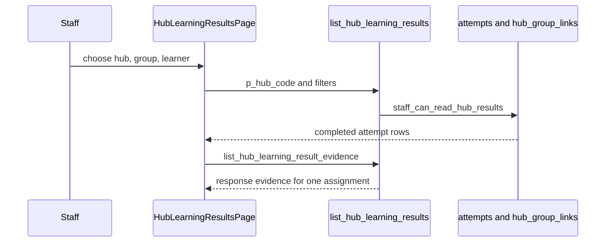
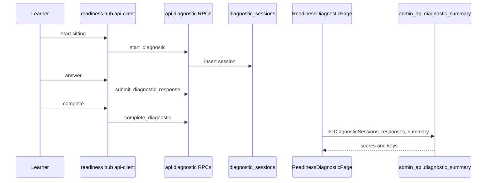

# 11 — End-to-end workflows

Each section is a workflow that the source actually performs, or a gap where the task list asked for a workflow the UI does not run. Diagrams match the call chain in the text.

## 1. Staff authentication

A staff member opens the portal, signs in with email and password, and sees the dashboard only if they are an active platform administrator.

| Step | Location |
| --- | --- |
| UI | `AdminSignIn` in `src/components/admin-access-gate.tsx` |
| Handler | `signIn` in `src/stores/admin-portal.tsx` |
| Service | `signInAdminWithPassword` in `src/services/supabase-admin-service.ts` |
| Request | `auth.signInWithPassword`, then `.from("current_staff_context")`, then `.from("dashboard_summary")` |
| SQL | View `admin_api.current_staff_context` (`learning.teachers`, `platform.staff_roles`, `learning.current_teacher_id()`). View `admin_api.dashboard_summary` |
| Security | JWT, then `sessionFromStaffContext` requires `platform_admin`. Dashboard empty is access denied |
| UI update | `AdminPortalFrame` swaps the gate for `AdminShell` |
| Errors | `mapSignInError` on the form. Forbidden message on `AdminAccessDenied`. Network errors on `AdminUnavailable` |
| Tests present | `tests/admin-auth.test.ts`, `tests/integration.test.ts`, `tests/admin-portal-navigation.test.ts`. Not executed |

Magic link and password recovery are the same provider with `signInWithOtp`, `verifyOtp` and `updateUser`. Recovery does not bootstrap admin data.

## 2. Learner management

**Read path, implemented.** **Create path, not implemented.**

| Step | Location |
| --- | --- |
| UI | `LearnersPanel` in `src/views/admin-people-panels.tsx` |
| Loader | `loadPeopleData` |
| Request | `listLearners` → `from("learners")` |
| SQL | `admin_api.learners` in `20260902100000_synthetic_qa_learner_fixtures.sql` |
| Tables | `learning.students`, `learning.enrolments`, `learning.groups` |
| Security | `platform.current_staff_has_role('platform_admin')` inside the view |
| UI update | Table of `studentNumber`, `displayName`, `groupCodes`, `activeEnrolmentCount` |
| Errors | `ModuleDataShell` and Retry |
| Tests present | Route and module-loading tests. No create-learner test, because create does not call the network |

Staff rows use `listTeachers` → `staff_roles`. “Invite a teacher” is the pending dialog.

## 3. Teaching group management

**Read path, implemented.** **Create and update, not implemented.**

`GroupsPanel` lists `admin_api.groups` (code, name, year group, academic year, course, active learner count, synthetic flags). “Create a group” calls `openPending`.

Classroom Group Generator is a different workflow and **is** implemented. It writes `learning.grouping_sessions`, not `learning.groups`.

| Step | Location |
| --- | --- |
| UI | `GroupGeneratorPage`, poll helper `src/views/grouping-poll.ts` |
| Requests | RPCs listed in [02 Admin Portal architecture](02_ADMIN_PORTAL_ARCHITECTURE.md) |
| SQL | `platform.*` definers, tables `learning.grouping_sessions`, `grouping_teams`, `grouping_participants` |
| Security | `require_grouping_platform_admin` on the staff functions. Learner join is `anon` |
| Errors | `rpcErrorMessage` into `setError`. No client → `"Platform not connected"` |
| Tests present | `tests/group-generator-poll.test.ts`, `tests/group-generator-roles.test.ts` |

Creating a real teaching group (`learning.groups`) remains a documentation gap in the portal. Seeds and migrations insert groups for local and catalogue data.

## 4. Activity assignment

**List, implemented. Create, not implemented.**

`AssignmentsPanel` (`src/views/admin-assessment-panels.tsx`) renders `loadAssignmentsResultsData` → `listAssignments` → `admin_api.assignments`. The button calls `openPending({ title: "Create an assignment" })`.

Publishing a curriculum is the closest implemented write. It is not an assignment.

| Step | Location |
| --- | --- |
| UI | `CurriculumAuthoringPage`, publication panel under `src/components/authoring/` |
| Handler | `publishCurriculum` on the portal context |
| Service | `publishCurriculum` in `supabase-admin-service.ts` |
| RPC | `admin_api.publish_curriculum` |
| SQL | `platform.publish_curriculum`, `platform.validate_curriculum_package`, insert into `platform.curriculum_publications`, catalogue projection |
| Security | `require_curriculum_author` inside the definer. The shell already required `platform_admin` |
| UI update | Publication status and cache invalidation |
| Errors | `AdminPublicationError` (validation, version regression, authorisation, conflict) |
| Tests present | `tests/publication.test.ts`, `tests/integration.test.ts` argument mapping |

Until an `activity_assignments` row exists for the learner’s group, `api.submit_attempt` raises `ACTIVITY_NOT_ASSIGNED`. Those rows are created by seed SQL and data migrations, not by this button.

## 5. Learner submission

Implemented. Detail and the Unit 3 sequence are in [06 Hub integration](06_HUB_INTEGRATION.md).

| Step | Location |
| --- | --- |
| UI | `src/pages/ActivityPage.tsx` `finishActivity` in `unit-3-Cyber-Security-Hub` |
| Hub handler | `submitCatalogueDraft` in `src/catalogue/activity-draft.ts` |
| Service | Core `createSubmissionService.submit` |
| RPC | `api.submit_attempt` eight arguments, body `20260923120000_timed_knowledge_report.sql` |
| Tables | `learning.students`, `enrolments`, `activity_assignments`, `activity_versions`, `questions`, `attempts`, `responses` |
| Security | `auth.uid()` only. Client scores discarded. Completed-attempt trigger blocks later edits |
| UI update | Reconcile `api.my_activity_progress` |
| Errors | `ACTIVITY_NOT_ASSIGNED`, `ACTIVITY_ASSIGNMENT_AMBIGUOUS`, `INVALID_ACTIVITY_VERSION`, `CLIENT_ATTEMPT_ID_CONFLICT`, `AUTHENTICATION_REQUIRED`, `INCOMPLETE_RESPONSE_SET` |
| Tests present | `tests/check-does-not-submit-attempt.test.js`, `tests/core-integration.test.js`, `tests/week1-final-submission.test.js` in the Unit 3 repo. Backend pgTAP under `supabase/tests/api`. Not executed |

Check uses `mark_formative_response` and must not be described as an attempt.

## 6. Progress tracking

Implemented as reads.

| Audience | Call | Computation |
| --- | --- | --- |
| Learner in a hub | `platform.progress.getProgress()` → `api.my_activity_progress` | View over the learner’s attempts |
| Learner, hub-scoped | `api.my_hub_activity_progress(hub_code)` | Completed attempts for `learning.current_activity_assignment_id` |
| Staff markbook | `listAttempts` and `createLearnerProgress` | Browser interpretation of the admin snapshot |
| Staff hub results | `list_hub_learning_results`, `summarise_hub_learning_results` | SQL. Formative checks are completion only |

Security for the staff calls is the platform-admin shell plus the view or `staff_can_read_hub_results`. Errors surface as `AdminReadError` or `error.message` on the hub-results panel.

Tests present: `tests/results-markbook.test.ts`, `tests/results-hub.test.ts`, `tests/backend-progress.test.js` in Unit 3.

## 7. Cross-hub reporting

Implemented when a platform administrator opens Results and picks a hub source, or opens Analytics.

The portal does not merge hubs by calling each hub’s website. One query with `p_hub_code` is the isolation. Analytics views are global for `platform_admin` and are not hub-filtered unless the pane’s client filter says so (`src/analytics/scope.ts`).

L3E has no query. The source is `unavailable`.

Tests present: `tests/results-hub.test.ts` (filter cascade and parameter names), `tests/analytics.test.ts`.

## 8. Diagnostic assessment results

Implemented. The learner sitting is the readiness hub. The staff view is the portal.

| Step | Location |
| --- | --- |
| Learner client | `level-3-it-year-1-readiness-hub/src/diagnostic/api-client.ts` |
| RPCs | `start_diagnostic`, `submit_diagnostic_response`, `complete_diagnostic` |
| Tables | `learning.diagnostic_sessions`, `learning.diagnostic_responses`. Marking specs in `learning.diagnostic_question_marking` (no RLS policy, not granted to the browser) |
| Staff UI | `src/views/readiness-diagnostic.tsx`, also results source induction and analytics pane `readiness-diagnostic` |
| Staff request | `listDiagnosticSessions`, `listDiagnosticResponses`, `listDiagnosticSummary` |
| Security | Learner RPCs are granted to `anon`. Staff views require `platform_admin`. Uniqueness index prevents a second sitting for the same reported student id, hub, course, key and version |
| Errors | `DIAGNOSTIC_ALREADY_COMPLETED`, `DIAGNOSTIC_HUB_UNKNOWN`, `DIAGNOSTIC_VERSION_INVALID`, `DIAGNOSTIC_SESSION_COMPLETED`, `INVALID_SESSION_ID` |
| Tests present | Backend `supabase/tests/api/diagnostic_*.sql`. Portal `tests/readiness-diagnostic.test.ts`, `tests/results-induction.test.ts` |

The diagnostic is not an `learning.attempts` workflow. Progress percentages in the markbook do not include it unless a pane joins the two on purpose. The induction results source shows the diagnostic. The assignment markbook shows attempts.

## Workflows that are gaps

| Requested workflow | Status |
| --- | --- |
| Administrator creates a teaching group | Dialog only |
| Administrator enrols a learner | Display only. Learners can self-join through `resolve_learner_hub_access` / `join_learner_hub_group` when the group policy allows it |
| Administrator assigns an activity to a group | Dialog only. Seeds and migrations insert `activity_assignments` |
| Direct message from a hub to the portal | No caller found |
